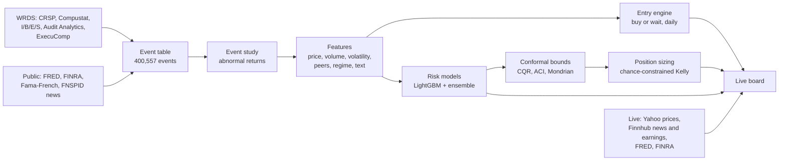
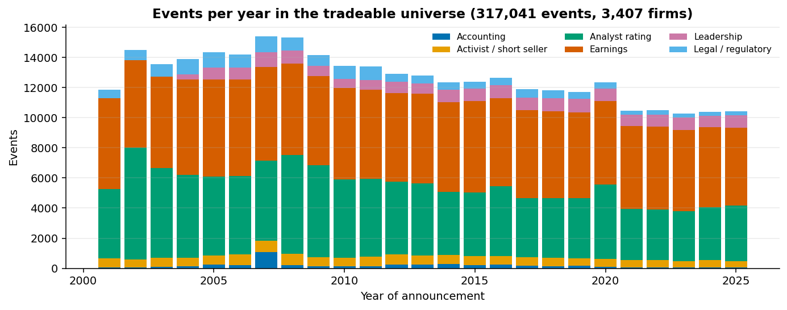
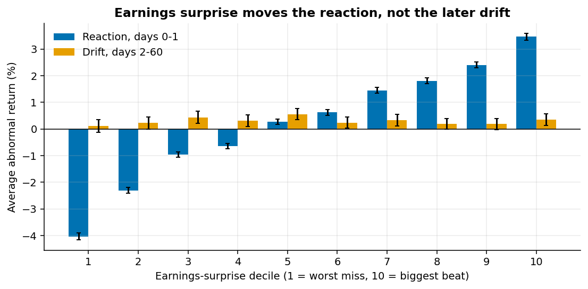
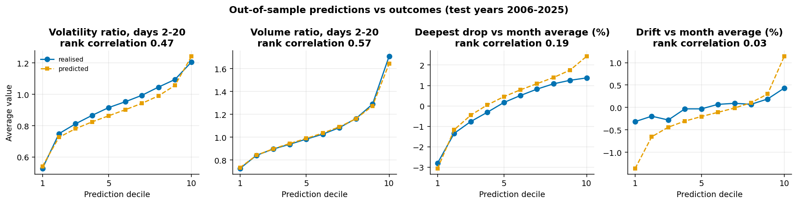

# Event Reaction Model: Risk, Timing and Position Sizing After Company News

This is a machine learning study of how US stocks behave in the weeks after company news. It started during a week of heavy headlines around Nvidia, with a simple question: when a company is hit by surprising news, what happens to its stock next, and is there a better time to buy than straight away?

To answer it, models were trained on 317,041 news events across 3,400 US companies from 2001 to 2025, covering earnings reports, analyst changes, leadership changes, lawsuits, accounting issues, activist campaigns and more. Every model was tested only on years it had never seen.

**What it found.** The direction of a stock after news is close to a coin flip, because markets price public news within a day or two. Risk is different. How much a stock will swing, how busily it will trade and how deep its dip may go can all be forecast, and better than the standard models used in finance. The bad cases hold as often as they promise, and position sizes built on them kept losses within their limits.

**Where this applies.** Forecasting risk after news is useful wherever someone has to act before the dust settles. Investors can size positions and set loss limits. Risk teams can plan for the swings that follow news. Options and volatility traders can price them, and market makers can prepare for the jump in trading.

**Settle** is the app that puts the models to work. For each stock, it shows a buy-or-wait call, how far the price may still fall, a bad case, and how much to put in so that a bad month stays within your loss limit. Live prices update throughout the day.

**Try Settle:** https://clairecwn.github.io/StockPredictionModel/

> This is a research project, not financial advice.

## Approach

Each choice below comes from how markets behave, and each one is tested the same way.

1. **Measure only the company's own move.** A stock that falls 3% on a day the market falls 3% has not reacted to its news. Every return is turned into an abnormal return by removing what the market and five other standard risk factors explain (an event study, as in MacKinlay, 1997).
2. **Use only what was known at the time.** Every input is fixed at the close of the day after the news. Earnings dates, prices and macro data are all lined up to the day they became public, so no forecast sees the future.
3. **Forecast risk, not direction.** Public news is priced within a day or two, so the direction of the next four weeks is close to a coin flip (the models confirm this at 51%). Volatility and trading activity cluster in time, so they can be forecast. Settle is built around them.
4. **Test on years the model has never seen.** Models are trained on earlier years and scored on later ones, with a 120-day gap so that no event's outcome leaks into training (purged walk-forward, López de Prado, 2018). The test years run from 2006 to 2025.
5. **Beat the models finance already uses.** Each forecast is compared with the standard benchmark on the same events. The volatility forecast scores 0.51 against 0.33 for the HAR model, and wins in 99% of test months.
6. **Make the bad case honest.** Bounds come from conformal prediction, which adjusts each range until it holds as often as it promises. A bad case meant to be passed 1 time in 10 was passed 9.4% of the time from 2021 to 2025.
7. **Size the position from the risk.** The amount to put in is the largest that keeps the chance of losing more than your limit below a set level (a chance-constrained Kelly rule). In testing, losses beyond the limit happened in 2.7%, 2.5% and 1.4% of trades, against promises of 5%, 10% and 10%.
8. **Keep only what holds up.** Thirteen experiments added new ideas one at a time. An idea was kept only if it beat the model without it, passed a Holm correction for testing many ideas at once, and still held from 2021 on. Most did not, and those results are reported below.
9. **Keep score in public.** Every live forecast is saved before its outcome is known and checked four weeks later.

The app shows the same reasoning for each stock: the call, the bad case, the amount to put in, and the inputs that pushed that call most (from LightGBM's per-forecast contributions).

## Contents

1. [Approach](#approach)
1. [Results at a glance](#results-at-a-glance)
2. [Success metrics](#success-metrics)
3. [Architecture](#architecture)
4. [Data](#data)
5. [Data cleaning](#data-cleaning)
6. [Exploratory analysis](#exploratory-analysis)
7. [Method](#method)
8. [Validation](#validation)
9. [Detailed results](#detailed-results)
10. [Live board](#live-board)
11. [Reproducing the results](#reproducing-the-results)
12. [Repository structure](#repository-structure)
13. [Limitations](#limitations)
14. [References](#references)

## Results at a glance

All figures are out of sample and come from the models used on the live board, which include the earnings-calendar, pre-event liquidity and volatility-gap features described under [Detailed results](#detailed-results). Test years run from 2006 to 2025 under purged walk-forward validation, which is described in the [Validation](#validation) section. A rank correlation of 0 means no skill and 1 means a perfect ordering of outcomes.

| What is predicted | Out-of-sample skill | Verdict |
|---|---|---|
| Volatility over days 2 to 20, relative to normal | rank correlation 0.51 (shuffled-label placebo -0.01) | Strong |
| Trading volume over days 2 to 20, relative to normal | rank correlation 0.66 | Strong |
| Deepest abnormal drop over days 2 to 20 | rank correlation 0.20; AUC 0.68 for the worst 20% (naive baseline 0.61) | Useful |
| Downside bound ("at most a 10% chance of falling below this") | breached 9.4% of the time in 2021 to 2025 | Calibrated |
| Buy-or-wait rule | entries 0.05 percentage points closer to the 20-day low than buying on day 1 (Holm-adjusted p = 0.020) | Small but significant |
| Position sizing tiers | losses beyond the stated limit in 2.7%, 2.5% and 1.4% of trades, against promises of 5%, 10% and 10% | Promises kept |
| Direction of the 20-day abnormal return | rank correlation 0.03, right sign 51% of the time | Not significant |
| When the 20-day low will come (five windows, from already passed to 11 or more days away) | log loss 1.14 against 1.27 for a day-count baseline; most likely window right 53% of the time against 48.5% | Useful |

The pattern is consistent across every method tried. Risk is predictable, because volatility and trading activity cluster in time. Direction is not, because the market prices news within a day or two. The project is therefore built around managing risk rather than forecasting returns.

## Success metrics

Each part of Settle makes a different promise, so each one is judged in the way that fits it. All the numbers below come from test years that the models never saw while they were being built.

### What works well

**Risk forecasts.** Settle's strongest forecasts are about risk: how much a stock will swing, and how busily it will trade, in the four weeks after news. To score them, every past event is ranked twice, once by its forecast and once by what actually happened, and the two rankings are compared. A score of 0 means the forecast ranks events no better than chance, and 1 means it ranks them perfectly. The volatility forecast scores 0.51 and the trading-volume forecast scores 0.67. The same models trained on shuffled outcomes, which can only find patterns by luck, score about 0. On the same events, the standard textbook model for volatility (the HAR model) scores 0.33, and Settle's model beats it in 99% of test months.

**Bad cases and ranges.** A bad case that says only 1 stock in 10 falls further should be passed about 10% of the time. From 2021 to 2025, it was passed 9.4% of the time. Every forecast also comes with a range that should hold the real outcome 8 times out of 10, and these ranges did so 79.7% to 80.0% of the time. The position sizes built on these bounds kept their promises as well. The three risk levels promise that no more than 5%, 10% and 10% of trades lose more than their limit, and in testing only 2.7%, 2.5% and 1.4% did.

**When the low will come.** This forecast is clearly better than guessing from the number of days since the news. Its most likely window was right 53.1% of the time, compared with 48.5% for the guess. Its chances can also be taken at face value: when it gave a 95% chance that the low had already passed, the low had passed 94.6% of the time.

### What works a little

**How far a stock may fall.** Settle can tell riskier events from safer ones, but it cannot say exactly how far a stock will fall. Its forecast of the deepest drop scores 0.20 on the same ranking scale, compared with 0.08 for the shuffled version. Its warning of a sharp drop is more useful than that score suggests: 35% of the stocks it warned about went on to one of the worst drops, compared with 15% of the rest.

**Buy or wait.** The call has a real but small edge. Following it bought stocks, on average, 4.78% above their lowest price of the four weeks. Buying the day after the news bought them 4.83% above it. The difference is small, but it is statistically significant, which is why the call is best used to time a purchase that was already planned.

**Earnings previews.** The forecast of how much a stock will move after its earnings report scores 0.37, just above the 0.36 scored by the stock's own past moves. It does not say which way the stock will move.

### What does not work

No model in this project can reliably say whether a stock will beat the market over the next four weeks. The best one scores 0.03 and picks the right direction 51% of the time, which is close to a coin flip and not statistically significant. This is what should be expected, because public news is priced within a day or two. For this reason, the board does not show a direction.

### How this compares with other work

Comparisons are only made where the task is close enough to be fair.

Professional investors judge stock-picking signals with the same ranking score. A score of about 0.05 is usually called strong (Zhang, Guo and Cao, 2020), so Settle's 0.03 for direction is in the normal range for real signals, even though it is not reliable enough to use here. Large studies find the same limits. Gu, Kelly and Xiu (2020) show that even the best machine-learning models explain less than 1% of monthly stock returns, and Fischer and Krauss (2018) found that the edge of deep learning on S&P 500 stocks disappeared after costs from 2010 on. A hit rate near 50% is therefore an honest result, not a weak one.

Studies also agree that volatility and trading activity are much easier to predict than direction, because calm and busy periods tend to last. Settle shows the same gap, with scores of 0.51 and 0.67 for risk against 0.03 for direction. Its volatility model also beats the standard textbook model on the same data, as the [benchmark experiment](#experiment-the-risk-models-against-standard-benchmarks) shows.

### All scores

| Forecast | How it is measured | Settle | Compared with |
|---|---|---|---|
| Volatility, next four weeks | ranking score (0 to 1) | 0.51 | HAR model 0.33; shuffled 0.00 |
| Trading volume, next four weeks | ranking score | 0.67 | recent volume 0.61; shuffled 0.02 |
| Deepest drop, next four weeks | ranking score | 0.20 | shuffled 0.08 |
| Warning of a sharp drop | share of warned stocks that had one of the worst drops | 35% | 15% of the rest |
| Bad case, 1 in 10 | share of stocks that fell further, 2021 to 2025 | 9.4% | promised 10% |
| Forecast ranges | share of outcomes inside the range | 79.7% to 80.0% | promised 80% |
| Position sizes (Safest, Balanced, Bold) | share of trades that lost more than the limit | 2.7%, 2.5%, 1.4% | promised at most 5%, 10%, 10% |
| When the low will come | most likely window right | 53.1% | 48.5% for a guess from the day count |
| Buy or wait | average entry above the four-week low | 4.78% | 4.83% for buying the day after the news |
| Earnings preview, size of the move | ranking score | 0.37 | 0.36 for the stock's own past moves |
| Direction, next four weeks | ranking score / right direction | 0.03 / 51% | 0.00 / 50% for shuffled |

The live board also records every forecast it makes (`docs/data/forward_log.csv`) and scores each one once four weeks have passed (`docs/data/forward_scores.json`). That record began in November 2026 and will be reported here once it holds enough events to judge.

## Architecture



The pipeline runs in four stages:

1. **Events.** Company news is collected from licensed databases, linked to stock returns, and filtered to a tradeable universe.
2. **Features and targets.** Each event is described by information known at the close of the day after the news, and labelled with what happened over the following weeks.
3. **Models.** Separate models forecast risk, entry timing and downside bounds. Every model is trained and tested with the same time-ordered splits.
4. **Live board.** The same feature code runs on free live data. A parity check confirms that the live features match the training features before any prediction is published.

## Data

| Source | Content | Period | Access |
|---|---|---|---|
| CRSP daily stock file | prices, returns, volume, market index | 2001 to 2025 | WRDS (licensed) |
| Compustat | identifiers, shares outstanding, short interest | 2001 to 2025 | WRDS (licensed) |
| I/B/E/S | earnings announcements, estimates, analyst recommendations | 2001 to 2025 | WRDS (licensed) |
| Audit Analytics | officer changes, legal cases, restatements, shareholder activism | 2001 to 2025 | WRDS (licensed) |
| ExecuComp | executive tenure and ownership | 2001 to 2025 | WRDS (licensed) |
| Fama-French 5 factors and momentum | daily factor returns | 2001 to 2025 | Kenneth French data library |
| FRED | VIX, economic policy uncertainty, high-yield spread, consumer sentiment | 2001 to present | free API |
| FINRA Reg SHO | daily short-sale volume | 2009 to present | free files |
| FNSPID | financial news headlines | 2009 to 2023 | free dataset |
| Yahoo Finance, Finnhub | live prices, company news, earnings calendar | live | free |

**Licence note.** WRDS data is licensed and is not included in this repository. Neither are models trained on it. The code expects the files in a git-ignored `data/` folder, and `docs/WRDS_GUIDE.md` lists exactly which files to download.

**Sample.** The raw event table holds 400,557 events. The tradeable universe keeps events where the stock traded at \$5 or more and was not in the smallest 20% of firms by market value that year. This leaves 317,041 events across 3,400 firms from 2001 to 2025. Small, illiquid stocks are excluded because their prices are noisy and their apparent patterns are too expensive to trade.

## Data cleaning

Raw records from different databases describe the same company with different identifiers and dates, so most of the cleaning work is linking and dating them correctly. The steps run in this order:

1. **Linking.** Compustat and Audit Analytics records are linked to CRSP stocks through the CRSP/Compustat Merged link history, using only links valid on the event date. I/B/E/S records use the official I/B/E/S-CRSP link first, with a CUSIP match as a fallback.
2. **Dating.** Each event is placed on the first trading day on or after its announcement date. Earnings dates come from I/B/E/S announcement dates, and an earnings release takes priority over an analyst rating change on the same firm and day.
3. **Same-day news.** Several items about one firm on one day are merged into a single event. The number of items is kept as a feature.
4. **History requirement.** An event needs at least 120 valid trading days in the estimation window (days $-250$ to $-30$), so that each stock's normal behaviour can be estimated.
5. **Tradeable universe.** Events are kept only if the stock closed at \$5 or more the day before and was not in the smallest 20% of firms by market value that year. This removes 83,516 of the 400,557 events.
6. **Outliers.** Return targets are clipped at their 0.5th and 99.5th percentiles, which removes data errors without discarding events. Volatility and volume ratios are floored at 0.05 before taking logs.
7. **Missing values.** Gradient boosting handles missing values directly, so gaps are left as missing rather than filled with guesses. Series that start late are blank before they begin by design: FINRA short-sale data starts in August 2009 and Compustat short interest in July 2006.
8. **Publication lags.** Every input is dated to when it was actually public. Short-sale volume is lagged one day, executive compensation data is dated July 1 of the following year, consumer sentiment is lagged one month, and short interest uses the raw reported figure rather than one adjusted for later stock splits.

## Exploratory analysis

The event mix is stable over time. Earnings and analyst rating changes make up most of the sample, while the rarer classes add a few thousand events each year.



Average abnormal returns after the announcement differ by event class. Analyst rating changes and leadership changes keep drifting for about 20 days in the direction of the news. Activist events make almost all of their move on days 0 and 1, and earnings events make about half of theirs then. The shaded bands are 95% confidence intervals, and they show that most of these drifts are small compared with the noise around them.


The size of an earnings surprise strongly predicts the immediate reaction but not the drift afterwards. This is the first sign that public news is priced quickly, which the models later confirm.




### 1. Abnormal returns

To separate a company's own news from moves in the wider market, each stock's normal behaviour is estimated over trading days $-250$ to $-30$ before the event with a six-factor model:

```math
r_{i,t} - r_{f,t} = a_i + \boldsymbol{\beta}_i^{\top}\mathbf{f}_t + \varepsilon_{i,t},
\qquad
\mathbf{f}_t = \left(\mathrm{MKT}_t,\ \mathrm{SMB}_t,\ \mathrm{HML}_t,\ \mathrm{RMW}_t,\ \mathrm{CMA}_t,\ \mathrm{UMD}_t\right)^{\top}
```

Single-stock loadings are noisy, so they are shrunk toward a typical stock, with a market beta of 1 and zero on the other factors:

```math
\tilde{\boldsymbol{\beta}}_i = 0.67\,\hat{\boldsymbol{\beta}}_i + 0.33\,\mathbf{e}_1
```

The abnormal return is the part of the return that the factors do not explain. The intercept $a_i$ is left out because past outperformance does not reliably persist:

```math
AR_{i,t} = \left(r_{i,t} - r_{f,t}\right) - \tilde{\boldsymbol{\beta}}_i^{\top}\mathbf{f}_t
```

### 2. Timing convention and targets

Day 0 is the announcement day. All features use only information available at the close of day 1, and every target measures what happens after that point. This means a position could actually be opened at the moment each prediction is made.

| Target | Definition |
|---|---|
| Reaction (feature) | $`CAR_{0,1} = AR_{i,0} + AR_{i,1}`$ |
| Drift | $`D^{(h)}_i = \sum_{t=2}^{h} AR_{i,t}`$ for $`h \in \{5, 20, 60\}`$ |
| Trough | $`T_i = \min_{2 \le k \le 20} \sum_{t=2}^{k} AR_{i,t}`$ |
| Volatility ratio | $`V_i = \dfrac{\sqrt{252}\,\mathrm{sd}\left(r_{i,2:20}\right)}{\sigma_i^{\text{pre}}}`$, where $`\sigma_i^{\text{pre}}`$ is the annualised volatility over days $`-60`$ to $`-1`$ |
| Volume ratio | $`U_i = \dfrac{\overline{\text{vol}}_{i,2:20}}{\overline{\text{vol}}_{i,\text{est}}}`$ |

Return targets are transformed in two ways before training. They are first demeaned within each calendar month, which removes market-wide swings that no stock-level model can predict. They are then divided by the noise expected over the horizon, so that a 5% move in a calm stock counts for more than the same move in a volatile one:

```math
y_i = \frac{D^{(h)}_i - \bar{D}^{(h)}_{m(i)}}{\hat{\sigma}_i \sqrt{h}}
```

Here $\hat{\sigma}_i$ is the stock's daily idiosyncratic volatility before the event and $m(i)$ is the event's month. The volatility and volume ratios are modelled in logs.

### 3. Features

The live models use 69 features, and the research models add the peer, positioning and text groups. The features fall into six groups:

- **Reaction:** $CAR_{0,1}$, the day-0 move in standard deviations, and abnormal volume on days 0 and 1.
- **Stock state:** momentum over 20, 60 and 250 days, distance from the 52-week high, beta, idiosyncratic volatility, Amihud illiquidity, dollar volume and size, plus how turnover and illiquidity changed in the month before the news.
- **Range-based volatility:** Yang-Zhang volatility over 5, 20 and 60 days (a HAR-style term structure) and the size of the reaction-day price range relative to normal.
- **Market regime:** VIX, economic policy uncertainty, the high-yield credit spread and consumer sentiment (lagged one month), plus market returns and volatility.
- **Peers and positioning (research mode):** the reaction of each stock's 10 most correlated peers from the previous year, short interest and the FINRA short-sale ratio (lagged one day).
- **Text (research mode):** supervised sentiment, sentence embeddings, novelty and analogue retrieval from headlines. These are described in the [Text models](#5-text-models) section below.

### 4. Models

**Gradient boosting.** The main model is LightGBM with the Huber loss, which behaves like squared error for small residuals and like absolute error for large ones. This limits the influence of extreme returns:

```math
L_{\delta}(y, \hat{y}) =
\begin{cases}
\tfrac{1}{2}(y - \hat{y})^2 & \text{if } |y - \hat{y}| \le \delta \\
\delta\left(|y - \hat{y}| - \tfrac{1}{2}\delta\right) & \text{otherwise}
\end{cases}
```

Hyperparameters are chosen inside each training window from a small grid. Events at the same firm within 30 days share most of their return window, so each event is down-weighted by its number of overlapping neighbours $n_i$. Each event class is also re-weighted so that the most common classes do not dominate:

```math
w_i = \frac{1}{1 + n_i} \cdot \frac{1}{\sqrt{\pi_{c(i)}}}
```

Here $\pi_{c}$ is the share of events in class $c$.

**Stacked ensemble.** For the volatility, volume and trough targets, LightGBM is combined with extremely randomised trees, ridge regression, a Huber linear model and a 1-D convolutional network. The blend weights are non-negative least-squares weights learned only from earlier test blocks, so the ensemble never sees the data it is scored on.

**Convolutional network.** The CNN reads the last 61 trading days of four channels: volatility-scaled abnormal returns, market returns, log volume and absolute returns. It uses three dilated convolutions with a receptive field of about 29 days, and it predicts the three risk targets jointly.

### 5. Text models

Headlines from days $-5$ to $+1$ around each event are scored in three ways:

- **SESTM** (Ke, Kelly and Xiu, 2019) learns which words go with positive or negative returns in this data. It screens words by how skewed their returns are, estimates positive and negative topic distributions $O^{+}$ and $O^{-}$, and scores each headline by penalised maximum likelihood:

```math
\hat{p} = \arg\max_{p \in [0,1]} \sum_{j} d_j \log\left(p\,O^{+}_j + (1 - p)\,O^{-}_j\right) + \lambda \log\left(p(1-p)\right)
```

  Each year is scored by a model trained only on earlier years. Tickers and words concentrated in a single firm are removed, so that the model cannot learn firm identities.
- **Sentence embeddings** (all-MiniLM-L6-v2) turn each headline into a 384-dimensional vector. These vectors give novelty (distance from the firm's recent news), dispersion across headlines, and the average outcome of the most similar past events.
- **FinBERT** gives a general financial tone score as a benchmark.

### 6. Entry timing

For each event, the entry engine builds one row per decision day $k = 1, \ldots, 15$, giving 4.7 million rows in total. Each row holds the event features plus 24 daily features: the path since the event, the distance from the running low, recent volume, and the close location within the day's range.

The label asks whether the price moves down before it moves up. With the barrier

```math
b = 0.75\,\hat{\sigma}_i\sqrt{5},
```

a row is labelled "waiting pays" if the price falls by $b$ before it rises by $b$ within the next 5 trading days. Rows where neither barrier is hit are left out of the label. A second model predicts the size of the next 5-day move in units of $\hat{\sigma}_i\sqrt{5}$, and the **expected-value rule** buys on the first day this forecast is positive.

As a second opinion, the timing problem is also solved as an optimal stopping problem with fitted Q-iteration. The value of waiting on day $k$ is

```math
V_k(s) = \min\left(P_k,\ C_k(s)\right),
\qquad
C_k(s) = \mathbb{E}\left[V_{k+1}(s') \mid s\right],
\qquad
V_{15}(s) = P_{15}
```

Here $P_k$ is the price relative to the event (in units of $\hat{\sigma}_i$) and $C_k(s)$ is the expected price paid by waiting optimally. The policy buys on day $k$ when $P_k \le C_k(s)$. Each $C_k$ is estimated backwards from day 15 with cross-fitted gradient boosting.

### 7. Downside bounds

A downside bound is a level the stock should fall below with probability at most $\beta$. It is built in three layers.

**Conformalised quantile regression** (Romano, Patterson and Candès, 2019). A quantile model $\hat{q}_\beta(x)$ is fitted, and its errors are measured on a later calibration window:

```math
c = \mathrm{Quantile}_{\lceil (n+1)(1-\beta) \rceil / n}\left(\hat{q}_\beta(x_j) - y_j\right),
\qquad
\text{bound}(x) = \hat{q}_\beta(x) - c
```

**Adaptive conformal inference** (Gibbs and Candès, 2021). In the backtest, the correction is updated month by month using outcomes that are already known (with a two-month lag), so the bound adapts when markets change:

```math
c_{t+1} = c_t + \gamma\left(\mathrm{err}_t - \beta\right), \qquad \gamma = 0.2
```

**Mondrian calibration** (Vovk et al., 2003). The live bound uses a separate correction within each fifth of stocks ranked by volatility. Without it, the promise held on average but was broken for the most volatile stocks.

### 8. Position sizing

Sizing works in total returns over a 19-day holding period. It combines three ingredients.

**Expected return.** A CAPM prior is combined with the event signal, shrunk by the skill the signal has actually shown. This follows Grinold's fundamental law of active management:

```math
\mu_i = \beta_i \cdot \mathrm{ERP} \cdot \frac{h}{252} + \mathrm{IC}_t \cdot \sigma_i^{\text{idio}} \sqrt{\frac{h}{252}} \cdot z_i
```

Here $\mathrm{ERP} = 6\%$ a year, $z_i$ is the standardised drift forecast, and $\mathrm{IC}_t$ is the out-of-sample rank correlation measured only on earlier years. If the signal decays, $\mathrm{IC}_t$ falls and the alpha term shrinks toward zero by itself.

**Risk.** Volatility is the Yang-Zhang estimate scaled by the predicted volatility ratio and by a calibration factor $\kappa_t$, which is also estimated on earlier years only:

```math
\sigma_i = \kappa_t \cdot \sigma_i^{\text{YZ}} \cdot \hat{V}_i \cdot \sqrt{\frac{h}{252}}
```

**Size.** The weight is the smallest of three limits: a chance constraint from the downside bound $q_\beta$, fractional Kelly, and a hard cap:

```math
w_i = \min\left(\frac{d}{\left|q_{\beta,i}\right|},\ \ k\,\frac{\mu_i}{\sigma_i^{2}},\ \ \text{cap}\right)
```

The first term is the exact single-stock solution of $\Pr\left(\text{loss} > d \text{ of the account}\right) \le \beta$. The three tiers are:

| Tier | Loss limit $`d`$ | Chance $`\beta`$ | Kelly fraction $`k`$ | Cap |
|---|---|---|---|---|
| Safest | 2% | 5% | 1/4 | 15% |
| Recommended | 4% | 10% | 1/2 | 25% |
| Bold | 8% | 10% | 3/4 | 40% |

**Several stocks at once.** When an account is split across up to three stocks, each stock's bad-case loss $\ell_j = w_j\left|q_j\right|$ is combined through a Ledoit-Wolf shrunk correlation matrix $C$ from the past 250 days. Correlations rise in sell-offs (Longin and Solnik, 2001), so $C$ is stressed toward 1 before use:

```math
C_s = C + 0.4\left(\mathbf{1}\mathbf{1}^{\top} - C\right),
\qquad
L_{\text{basket}} = \sqrt{\boldsymbol{\ell}^{\top} C_s\, \boldsymbol{\ell}}
```

All weights are scaled down until $L_{\text{basket}} \le d$, and the total invested never exceeds 80% of the account.

## Validation

Financial data makes overfitting easy, so the evaluation is deliberately strict.

- **Purged walk-forward splits.** Test blocks are 2006 to 2010, 2011 to 2015, 2016 to 2020 and 2021 to 2025. Each model is trained only on data from before its test block, with a 120-day gap so that return windows never overlap.
- **Shuffled-label placebos.** Every model is re-run with shuffled targets. Real skill must clearly beat the placebo.
- **Naive baselines.** Downside models must beat a simple ridge regression on the reaction and pre-event volatility, and the "new low" model must beat a model that only counts days since the event.
- **Multiple-testing correction.** Trading rules and entry strategies are compared with Holm-adjusted p-values. The t-statistics are computed on monthly averages, because events in the same month are not independent.
- **Untouched test period.** Thresholds and tier settings are chosen on 2006 to 2015 and reported on 2016 to 2025.
- **Leakage audit.** The pipeline was checked for look-ahead bias, and several leaks were found and fixed: same-day short-sale data, split-adjusted short interest, compensation data dated before its release, and earnings dates known only after the fact. Each is now lagged to the date it was actually public.

## Detailed results

### Risk forecasts

| Target | Ridge (live features) | LightGBM (live features) | Stacked ensemble (all features) | Placebo |
|---|---|---|---|---|
| Volatility ratio, days 2 to 20 | 0.49 | 0.51 | 0.48 | -0.01 |
| Volume ratio, days 2 to 20 | 0.62 | 0.66 | 0.59 | 0.02 |
| Trough, days 2 to 20 | 0.16 | 0.20 | 0.20 | 0.08 |
| Drift, days 2 to 20 | 0.02 | 0.03 | 0.03 | 0.00 |

The values are Spearman rank correlations, computed out of sample. The first two columns come from the models used on the live board, and the ensemble column from the full research models. The 80% prediction intervals contain the realised outcome 80% of the time for every target, and they are narrower for large firms than for small ones.

The figure below sorts events into ten groups by their prediction and compares the average prediction with the average outcome in each group. For volatility and volume, the realised values rise steadily with the prediction. For the 20-day drift, the realised line is almost flat, which is what a rank correlation of 0.03 looks like.



### Drift and earnings surprises

Post-earnings announcement drift (Bernard and Thomas, 1989) does not appear in this sample. Average 60-day drift is flat across deciles of standardised earnings surprise, even though the day-0 and day-1 reaction rises steadily from $-4.1\%$ for the worst misses to $+3.4\%$ for the biggest beats. This matches recent evidence that the anomaly has disappeared in liquid stocks (Martineau, 2022). A long-short drift strategy earns a positive raw return over 2006 to 2025, but no version is significant after the Holm correction, and returns since 2021 are negative after trading costs.

### Entry timing (2016 to 2025, untouched)

| Strategy | Average distance above the 20-day low | Holm-adjusted p vs day 1 |
|---|---|---|
| Buy at the close of day 1 | 4.83% | |
| Expected-value rule | 4.74% | 0.001 |
| Optimal stopping (fitted Q-iteration) | 4.74% | 0.09 |

The live board uses the expected-value rule retrained on live features, which keeps a significant edge (4.76%, Holm-adjusted p below 0.001).

### Position sizing ($200 account, 2016 to 2025)

| Tier | Average stake | Promise | Realised breach rate | Worst 1% outcome |
|---|---|---|---|---|
| Safest | \$20.79 | at most 5% chance of losing more than \$4 | 2.7% | \$-5.56 |
| Recommended | \$39.32 | at most 10% chance of losing more than \$8 | 2.5% | \$-10.93 |
| Bold | \$63.52 | at most 10% chance of losing more than \$16 | 1.4% | \$-18.16 |

With a single correction for all stocks, the calmest fifth was over-protected and the most volatile fifth broke the 10% promise (11.8%). Calibrating each volatility bucket separately brings that down to 11.4%, and to 6.3% against the 5% promise. Part of the remaining gap comes from 2025 being a riskier year than 2024, when the corrections were set, which affected every bucket.


When three stocks are bought on the same day, scaling the basket with the stressed correlation keeps the breach rate at 6.3% against a promise of 10%. Sizing each stock separately and adding the results breaches 16.8% of the time.

### Monte Carlo simulation of an account

The backtest shows what happened trade by trade, but not what a year of trading could look like. To see this, a \$200 account is simulated 10,000 times. Each simulated year draws one calendar year from 2016 to 2025 at random, so that calm and stressed markets appear in realistic proportions. It then takes 12 trades from that year in date order, since each position is held for 19 trading days. Each trade invests the tier's weight $w$ of the current balance:

```math
A_{k} = A_{k-1}\left(1 + w_k\, R_k\right),
\qquad
\text{drawdown} = \max_{k}\left(1 - \frac{A_{k-1}\left(1 + w_k\, L_k\right)}{\max_{j < k} A_j}\right)
```

Here $R_k$ is the trade's 19-day total return and $L_k$ is its worst point while held. Every trade comes from the out-of-sample backtest, so no simulated result uses a model that saw the outcome. The same simulation is run for a fixed 10% stake and for putting the whole account into every trade.

| Strategy | Median end value | 90% range of end value | Chance of ending down 10% or more | Median largest fall | 95th percentile largest fall |
|---|---|---|---|---|---|
| Safest | \$201.78 | \$190.49 to \$213.03 | 0.6% | 2.5% | 6.5% |
| Recommended | \$203.97 | \$183.27 to \$226.54 | 3.2% | 4.7% | 12.1% |
| Bold | \$206.29 | \$172.66 to \$244.48 | 9.7% | 7.6% | 19.6% |
| Fixed 10% stake | \$202.62 | \$191.76 to \$215.55 | 0.2% | 2.6% | 7.2% |
| All in (100%) | \$219.17 | \$121.67 to \$390.55 | 27.3% | 23.9% | 56.8% |

The tiers behave as designed. Moving from Safest to Bold raises the median result, but it also widens the range and deepens the worst falls. Putting the whole account into every trade has the highest median, because stocks rose on average over 2016 to 2025, but it also loses 10% or more in about one simulated year in four, with a typical fall of nearly a quarter of the account.

The simulation also shows a limit of the model. The Safest tier does no better than simply staking a fixed 10% on every trade, because the expected-return signal is too weak to pick better trades. The value of the sizing rules lies in keeping each tier's losses inside a stated limit, not in raising returns.


### Experiment: the earnings calendar

The first version of the risk models did not know when a company would next report earnings. A report that falls inside the 20-day holding window brings a scheduled jump in volatility and trading, so this information should matter. Four groups of features were tested, each added to the existing model and scored month by month on the same walk-forward test years:

| Feature group | What it measures | Kept |
|---|---|---|
| Earnings calendar | whether the next report is expected inside the window, estimated only from past report dates | yes |
| Earnings sensitivity | the stock's average reaction on its previous eight earnings days | yes |
| Firm memory | how the same stock behaved after its previous events | research models only |
| Analyst revisions | the change in the consensus earnings forecast over one and three months | no |

A group was kept only if it beat the existing model after a Holm correction across all 25 tests and the gain also held from 2021 on. In the live models, the volatility forecast improved from a rank correlation of 0.47 to 0.49, volume from 0.57 to 0.60 and the deepest drop from 0.19 to 0.20. The volume gain held in 95% of test months. None of the groups improved the direction forecast, which supports the finding that public news is priced quickly.

### Experiment: meta-labeling the Buy/Wait call

The Buy/Wait call is right only about 51% of the time, so a second model was trained to recognise when a call is more likely to be right (López de Prado, 2018). It learned only from the call's out-of-sample history in earlier years and had to beat a simple alternative: trusting a call more when its forecast sits further from the cut-off. On 2016 to 2025 it did not. Its ability to separate right from wrong calls matched the simple alternative (AUC 0.509 against 0.509), and the hit rate rose only from 50.0% in its least-trusted fifth of calls to 51.8% in its most-trusted fifth. Neither decision rule built on it improved entries after the Holm correction. The timing signal is small and evenly spread, with no pocket of situations where it becomes reliable, so the board keeps the plain rule.

### Experiment: earnings preview

A quiet stock with an earnings report coming up had nothing on the board, even though the report is the most predictable source of risk it faces. A second set of models was therefore trained on the 146,709 past earnings reports, using only information known at the close before each report, to forecast the size of the two-day reaction and the deepest fall over the following four weeks. To pass, a forecast had to beat two rules of thumb month by month on 2016 to 2025: the stock's own average move over its last eight reports, and its pre-report volatility.

| Forecast (live features) | Model | Own usual move | Pre-report volatility | Result |
|---|---|---|---|---|
| Size of the two-day move | 0.369 | 0.355 (t = 6.8) | 0.264 (t = 11.2) | Passed, shown on the board |
| Deepest fall over four weeks | 0.180 | 0.134 (t = 5.7) | 0.174 (t = 1.2) | Failed at first |
| Deepest fall, with analyst disagreement | 0.186 | 0.134 (t = 6.3) | 0.174 (t = 2.6) | Passed, shown on the board |

The predicted move sizes are well calibrated: in each fifth of reports ranked by the forecast, the average predicted move is within 0.2 percentage points of the realised one. The model also picks out reports that move at least twice the stock's usual amount (AUC 0.66). An upper bound that the move should exceed only 1 time in 10 is recalibrated on the latest 12 months, and on 2016 to 2025 it was exceeded in 10.2% of reports. The direction of an earnings reaction was not forecast, because nothing in this project has shown that direction is predictable.

The first research run of this experiment reported a much higher score, which turned out to come from a leak: several news features were built from headlines on the report day and the day after. Once those were removed, the research features still improved the move forecast from 0.369 to 0.394, mostly through analyst forecast disagreement, short interest and how closely the stock moves with its peers. These are not available from free live data, so the board uses the live version.

A follow-up test added analyst disagreement, the spread of analysts' earnings estimates relative to their average, together with the number of analysts. It did not improve the move forecast (monthly t = 0.02), but it lifted the drawdown forecast past the volatility rule, so the board now shows both. Training uses the I/B/E/S standard deviation of estimates. The board only has Yahoo's lowest and highest estimate, so it converts the range with the standard result that the range of $n$ normally distributed estimates averages $d_n$ standard deviations ($d_n \approx 2.3$ for five analysts). The two measures agree on average but not stock by stock, which is a known source of error on the board.

### Experiment: volatility decay and a structural bad case

After a shock, a stock's extra volatility fades roughly as a power law of the day number, the same shape as aftershocks after an earthquake (the Omori law). Fitting $m(k, s) = 1 + A\,s\,k^{-p}$ to squared daily abnormal returns, with $s$ the size of the day-0 shock, gave $p$ between 0.4 and 0.7 depending on the period, so about a third of the extra volatility is gone by day 5. Adding up the decaying variance over the holding period and applying the reflection principle for random walks gives each event a structural bad case, $-1.645\sqrt{V}$ for the 1-in-10 level.

These structural features were added to the downside-bound models and scored on 2016 to 2025 by pinball loss, the standard score for quantile forecasts. They improved the 5% bound slightly (monthly t = 2.8) but not the 10% bound (t = -0.1), so they were not adopted. The gradient-boosted bound models already capture how risk scales with the size of the shock. The test also showed that, with calibration fixed before each test block, the most volatile fifth of stocks was not under-protected (6.7% to 6.9% breaches against a 10% promise). The small excess seen in the live calibration check therefore comes from 2025 being a riskier year, not from a blind spot for volatile stocks.

### Experiment: links between companies, liquidity and stock splits

News about one company can move others: rivals in the same industry, firms named in the same headline, customers and suppliers, or peers caught up in a scandal. Before an announcement, trading can also pick up as informed investors act, and a stock split is a choice that managers may use to signal confidence. Five groups of features were built from data already in the project and tested the same way as the earnings calendar, with a Holm correction across all 30 tests:

| Feature group | What it measures | Result |
|---|---|---|
| Liquidity and trading activity | change in turnover and Amihud illiquidity over the 20 days before the news against the year before, zero-return days, and the trading run-up in the last five days | Kept |
| Stock splits | a forward or reverse split in the past year, found where shares outstanding jump and the price moves by the inverse factor | No |
| Scandal contagion | accounting or legal events at the 10 most correlated peers in the month before | No |
| News co-mentions | the reaction of firms tagged in the same headlines last year (2010 to 2023), and headlines about lawsuits, accusations or criticism between them | No |
| Customers and suppliers | the returns of a firm's major customers and suppliers named in its filings (Compustat segments, 2000 to 2025), usable 90 days after the filing date | No |

The liquidity group lifted the forecast of trading volume over the next four weeks from a rank correlation of 0.616 to 0.665, better in 99% of test months (monthly t = 35) and by the same amount from 2021 on. Trading activity persists: a stock whose trading was already rising before the news keeps trading heavily after it, and the model previously saw only the spike on days 0 and 1. All but the bid-ask spread can be rebuilt from free daily data, so the live models use it too.

None of the groups predicted direction. The customer-supplier test was the most likely candidate, because Cohen and Frazzini (2008) found that suppliers' returns follow their customers' returns with a delay. Around company news it found nothing: the correlation between customers' returns over the previous month and the supplier's drift over the next month was 0.002. That effect was measured on monthly portfolios of all stocks and may also have faded since it was published. The drift after stock splits reported by Ikenberry, Rankine and Stice (1996) did not appear either, consistent with later work finding it has weakened.

One pattern is worth further work. The volatility forecast's errors line up with the trading run-up before the news (monthly t = -9.4 from 2021 on): when trading was already elevated, volatility rose less afterwards than predicted. Adding the raw features did not help the tree model use it, so it is not yet in the forecasts.

### Experiment: volatility mean reversion and insider trading

The volatility target divides the next four weeks' volatility by the volatility of the previous 60 days. When those 60 days were unusually calm or unusually wild for the stock, the ratio tends to move back towards normal. Tree models are poor at building ratios from raw inputs, so the model was given the gaps directly, as logarithms of long-run, last-week and range-based volatility over the 60-day level. This lifted the volatility forecast from a rank correlation of 0.488 to 0.499, better in 80% of test months (monthly t = 10.0) and by the same amount from 2021 on. The features are simple transformations of inputs the live board already has, so the live models use them, and the live volatility forecast rose from 0.49 to 0.51.

Insider trades came from the SEC's free Form 4 data sets: 3.35 million open-market purchases and sales from 2006 on, 91% matched to a stock. Following Cohen, Malloy and Pomorski (2012), an insider who traded in the same calendar month in each of the previous three years was treated as routine, and one who traded every year but off that pattern as opportunistic, since only the second group's trades are known to carry information. Only trades filed by the day after the news were used. Neither all insider trades nor opportunistic trades alone improved any forecast after the Holm correction; the best was opportunistic buying on 60-day drift (monthly t = 1.5). Only 2.3% of events had an opportunistic purchase in the 90 days before, so the signal may be real but too rare to matter at the level of all events.

### Experiment: limits to arbitrage

Mispricing should survive only where it is expensive to trade away (Shleifer and Vishny, 1997). Each month, events were split into five groups by a friction score, the average rank of Amihud illiquidity, idiosyncratic volatility, small size, low analyst coverage and the bid-ask spread. The out-of-sample drift forecast does rank stocks better as friction rises: for the 60-day drift, its monthly rank correlation is 0.031 in the least frictional fifth and 0.052 in the most frictional, and the gap between the forecast's top and bottom fifths grows from 1.0% to 2.5% over 60 days before costs.

The second test asked whether that gap survives three corrections: Newey-West standard errors for the overlap between 60-day returns in consecutive months, a cost of the quoted spread plus 0.10% on each leg with a borrowing fee of up to 5% a year for the short leg, and a split into 2006 to 2015, 2016 to 2025 and 2021 to 2025. A result counted only if it stayed positive with t above 2 in both recent periods. None of the long-short results did. In the most frictional fifth, the 60-day gap of 2.0% in 2016 to 2025 shrank to 0.4% after costs (t = 0.7), and from 2021 the net result was negative. A long-only version, buying the forecast's top fifth, did pass in the fourth friction fifth with the research features (1.1% over 60 days in 2016 to 2025, t = 3.7; 1.0% in 2021 to 2025, t = 2.6), but not with the live features (t = 1.9 and 1.2), and it is one of 20 combinations tried, so it does not survive a correction for multiple testing.

The pattern is what the theory predicts: the drift that the model can see is largest exactly where trading costs absorb it. The forecast carries information about direction, but not enough to pay for acting on it, which is why the board does not give directional calls.

### Experiment: when will the low come?

The first timing model answered a narrow question, whether today's new low would hold, and it added nothing to a baseline that only counts the days since the news (AUC 0.57 for both). A more useful question for someone waiting to buy is how many more trading days are likely to pass before the lowest close of the 20 days after the news. A multiclass LightGBM model estimates the chance of five windows from the close of each decision day: the low has already passed, or it comes in 1 to 2, 3 to 5, 6 to 10, or 11 or more trading days. It uses the same features as the buy-or-wait model, including where the price sits relative to its lowest close so far, and is scored on the purged walk-forward folds against a baseline that knows only the day number.

The model's log loss is 1.14 against 1.27 for the baseline, and it beat the baseline in 99% of test months from 2016 on (monthly t = 72). Its most likely window is right 53% of the time, against 48.5%. It is also well calibrated: when it gives a 69% chance that the low has already passed, the realised rate is 67%, and across all events the average predicted share of each window is within 1.2 percentage points of the realised share. Much of this skill comes from where the price sits relative to its low so far and how long ago that low was set, which a reader can see on a chart but would struggle to turn into a probability. The board shows the five chances for every stock in its event window.

### Experiment: investor attention

Da, Engelberg and Gao (2011) found that a jump in retail attention predicts a short-lived rise and a later reversal. Wikipedia page views are a free daily measure of attention, so views from July 2015 on were downloaded for the 1,801 event firms that Wikidata links to an English article (6.8 million firm-days). Three features used views up to day 0 only: the firm's normal level of attention, the build-up over the month before the news, and the spike around the news. Because the data starts in 2015, the test was scored on 2017 to 2025, where 78% of events have page views.

None of the forecasts improved after the Holm correction, with the research or the live features. The closest was the deepest-drop forecast (monthly t = 2.0, Holm p = 0.15). One pattern is worth noting: the attention spike lines up with the part of the 60-day drift the model gets wrong (monthly t = 3.3 with the live features, Holm p = 0.02; t = 2.9 with the research features, Holm p = 0.06), so stocks that drew unusual attention around the news did slightly better over the next three months than predicted. That fits the attention literature, but the effect is small, the ablation did not confirm it, and the data covers only nine years, so it was not added to the models.

### Experiment: price patterns

Four well-documented price patterns were tested, all built from daily prices that free live data can supply: how much of the news reaction came overnight rather than during trading (Lou, Polk and Skouras, 2019), lottery-like behaviour measured by the largest and smallest daily returns of the past month and the skewness of returns (Bali, Cakici and Whitelaw, 2011), short-term reversal over the past week (Jegadeesh, 1990), and return seasonality in the same calendar month of earlier years (Heston and Sadka, 2008).

None of them predicted direction. Together, though, they improved the volatility forecast (monthly t = 9.1 with the live features, better in 79% of test months) and the volume forecast (t = 6.3), and both gains held from 2021 on. Most of the volatility gain came from the lottery measures: a stock that recently had one very large daily move tends to stay jumpy after news, which the 60-day volatility average understates. All four groups were added to the research and live models.

### Experiment: news the market ignores, and the tone of headlines

Two questions were tested on 1.5 million firm-days with headlines (2009 to 2023). First, does company news that barely moves the stock on the day matter later? A headline was called quiet when the stock stayed within 2 standard deviations of its normal move, on normal volume, on the news day and the day after. Compared with the same firm's ordinary days in the same month, quiet news was not followed by more large moves over the next four weeks (33.2% against 33.4%). Quiet leadership news, such as reports that a former chief executive may return, was followed by slightly fewer large moves than usual. The one exception was quiet earnings headlines, which were followed by more large moves, but these are mostly previews of a report that the earnings calendar already covers.

Second, does the tone of a headline tell us which way the stock will go? At first sight it did: quiet headlines with bullish words were followed by the stock falling 0.65% behind the market over the next four weeks, and bearish ones by a small gain, a gap with a monthly t-statistic of 7.9. The effect did not survive the checks, however. Once the regression controlled for the stock's own move on the news days and over the previous week, the effect shrank to t = -1.8. Among tradeable stocks it fell to t = -0.9, and from 2016 on it was gone (t = -0.2). Many bullish words describe a price rise that has already happened, so most of the apparent signal was ordinary short-term reversal. Neither result was added to the models.

### Experiment: the risk models against standard benchmarks

A placebo shows that a model has found something real, but not whether a simpler, well-known method would do just as well. This experiment (`src/experiments/11_benchmarks.py`) runs the standard methods on the same events and the same purged walk-forward folds as the live models.

For volatility, the usual benchmark is the HAR model (Corsi, 2009), which forecasts from the volatility of the last day, week and month. Written in the same ratio form as the live target, it reaches a rank correlation of 0.33, or 0.36 when the stock's long-run level is added. For volume, the benchmarks assume trading stays as busy as it was just before the news. For the deepest drop, they use volatility alone or a linear model on the same features.

| Target | Benchmark | Benchmark | Live model | Months the live model is better | t |
|---|---|---|---|---|---|
| Volatility, days 2 to 20 | persistence (last 20 days) | 0.28 | 0.51 | 98% | 34.2 |
| | HAR (day, week, month) | 0.33 | 0.51 | 99% | 42.0 |
| | HAR plus long-run level | 0.36 | 0.51 | 97% | 33.6 |
| Volume, days 2 to 20 | persistence (week before) | 0.51 | 0.66 | 100% | 57.6 |
| | linear model on recent volume | 0.61 | 0.66 | 99% | 35.5 |
| Deepest drop, days 2 to 20 | volatility only | 0.13 | 0.20 | 72% | 8.0 |
| | ridge, same features | 0.17 | 0.20 | 76% | 9.6 |

The live models beat every benchmark, and every gain holds from 2021 on. The margin is largest for volatility, where knowing what kind of news hit the stock, how the market reacted and whether an earnings report is due adds a great deal to its recent volatility alone.

### Experiment: averaging, tuning, the volatility forecast and peer reactions

This batch (`src/experiments/12_model_tweaks.py`) tested four common ways to squeeze more out of the same data, using the same rules as before: a change is kept only if its gain is significant after the Holm correction and still holds from 2021 on.

| Change | Volatility | Volume | Deepest drop | 20-day drift |
|---|---|---|---|---|
| Current live model | 0.512 | 0.664 | 0.197 | 0.031 |
| Average of five models with different random seeds | 0.514 | 0.665 (passes) | 0.197 (passes) | |
| Settings tuned inside each training window | 0.515 (worse by month) | 0.666 (worse by month) | 0.197 | |
| Volatility and volume forecasts as inputs | | | 0.198 | 0.032 |
| How the stock's 10 closest peers moved | 0.513 | 0.664 | 0.195 | 0.034 |

Averaging five models passed for volume and the deepest drop, but the gain is less than 0.001 on a scale where the models score 0.2 to 0.66. That is too small to change anything a user sees, so the live models stay as they are. Tuning the settings looked slightly better over all years together but was worse in most months, which is a sign of fitting noise. Feeding the volatility forecast into the drop model, and knowing whether peers moved too, did not pass. Together with the earlier experiments, this suggests the free daily data is close to fully used, and that bigger gains would need new kinds of data, such as option prices.

### Experiment: calls for stocks without recent news

Most stocks on any given day have had no company news, so the news models have nothing to say about them. This test (`src/experiments/13_quiet_days.py`) asks whether price and volume alone carry a usable signal on those quiet days. It uses 1.27 million quiet stock-days from 2006 to 2026 (one every five trading days, stocks above $5 and outside the smallest 20% by market value) and the same walk-forward folds as the other models. The ideas come from the literature: short-term reversal (Jegadeesh 1990; Lehmann 1990), nearness to the 52-week high (George and Hwang 2004), momentum, RSI, moving-average gaps, and changes in volatility and volume.

| Forecast | Target | Monthly rank correlation | t | From 2021 |
|---|---|---|---|---|
| LightGBM, all price features | next 5 days against the market | 0.024 | 4.7 | 0.013 |
| Last week's move against the market, reversed | next 5 days against the market | 0.031 | 7.0 | 0.031 |
| LightGBM, all price features | deepest fall against the market over 20 days | 0.091 | 17.8 | 0.110 |
| Rising volatility alone | deepest fall over 20 days | 0.035 | 10.3 | 0.046 |

For buy or wait, the simple reversal rule beat the model and held up from 2021, so the live board uses the rule. Among large stocks, those that rose more than the market over a week went on to trail it the next week (48 to 49 cases in 100 beat the market), and this held from 2021. Stocks that fell more than the market used to bounce, but that stopped holding from 2021, so those Buy calls are shown as a slight lean. For the size of the coming dip, the model is far stronger and also improved from 2021, so the live board uses a version of it built only from features that free daily prices can rebuild.

Each call on the page now shows how often similar past cases went its way, as a slight lean, a mild lean or a clearer call. For calls after news, the odds come from the entry engine's test years: the strongest tenth of Buy calls beat the market over the next week in 53 of 100 cases, and the middle of the range is close to a coin flip.

### Why the headline numbers are modest

Published stock models often report directional accuracy of 90% or more. In almost every case, figures like this come from one of five problems:

1. **Look-ahead bias:** features that were not yet known on the prediction date.
2. **Price-level targets:** tomorrow's price is close to today's, so any model looks accurate.
3. **Class imbalance:** most days have small moves, so predicting "small move" always scores well.
4. **Test-set selection:** many models are tried and the best test score is reported.
5. **Single-stock or single-period tests:** a pattern that held for one stock in one period rarely generalises.

This project avoids all five, so its accuracy for direction sits close to 50%, which is consistent with efficient pricing of public news. A directional accuracy far above that on this kind of data would be treated as a sign of leakage rather than as success.

## Live board

<!-- LIVE-BOARD:START -->
_Updated 2026-11-18 02:32 UTC. Research only, not financial advice._

516 stocks checked; 378 have company news in the last 15 trading days. The 40 most recent calls are listed below; the page shows all of them.

| Stock | Price | Event (day 0) | Day | Signal | Expected further dip | Most likely timing of the 20-day low | 1-in-10 worst point (20 days) | Risk vs normal | Balanced size |
|---|---|---|---|---|---|---|---|---|---|
| PDD | 77.39 | earnings guidance (2026-11-16) | 1 | WAIT | 4.2% | in 11+ days (43%) | -7.3% | 1.03x | 9% |
| SO | 94.64 | price or volume shock (2026-11-13) | 1 | WAIT | 3.0% | in 11+ days (43%) | -3.9% | 0.88x | 9% |
| NVDA | 156.14 | price or volume shock (2026-11-12) | 2 | BUY (high drop risk) | 4.8% | in 11+ days (36%) | -15.1% | 1.06x | 12% |
| AMAT | 350.25 | earnings guidance (2026-11-12) | 2 | BUY (high drop risk) | 6.0% | in 11+ days (39%) | -20.1% | 0.82x | 20% |
| CRWV | 49.88 | price or volume shock (2026-11-12) | 2 | BUY (high drop risk) | 11.1% | in 11+ days (41%) | -25.9% | 0.81x | 0% |
| CSCO | 94.52 | earnings guidance (2026-11-12) | 2 | BUY | 4.3% | in 11+ days (38%) | -8.5% | 0.86x | 25% |
| GPN | 89.82 | price or volume shock (2026-11-12) | 2 | WAIT | 5.2% | in 11+ days (43%) | -11.2% | 0.85x | 4% |
| NBIS | 107.13 | earnings guidance (2026-11-12) | 2 | BUY (high drop risk) | 12.0% | in 11+ days (40%) | -26.8% | 0.86x | 10% |
| XEL | 81.21 | price or volume shock (2026-11-12) | 2 | WAIT | 3.6% | in 11+ days (43%) | -3.9% | 0.79x | 6% |
| SE | 71.63 | earnings guidance (2026-11-10) | 4 | BUY (high drop risk) | 5.2% | in 11+ days (34%) | -15.0% | 1.13x | 17% |
| AKAM | 84.15 | price or volume shock (2026-11-10) | 4 | BUY (high drop risk) | 6.2% | in 11+ days (36%) | -17.9% | 0.84x | 0% |
| FOXA | 67.95 | price or volume shock (2026-11-10) | 4 | WAIT | 4.9% | already passed (42%) | -8.3% | 0.70x | 0% |
| TDG | 1203.21 | earnings guidance (2026-11-10) | 4 | WAIT | 3.5% | already passed (36%) | -8.8% | 0.90x | 12% |
| AXON | 306.44 | price or volume shock (2026-11-09) | 5 | BUY (high drop risk) | 6.2% | already passed (38%) | -18.9% | 0.87x | 19% |
| CEG | 277.82 | earnings guidance (2026-11-09) | 5 | WAIT | 4.6% | already passed (62%) | -13.8% | 0.88x | 4% |
| CHTR | 138.50 | price or volume shock (2026-11-10) | 5 | WAIT (high drop risk) | 6.1% | already passed (49%) | -13.8% | 0.83x | 0% |
| CLX | 106.70 | price or volume shock (2026-11-10) | 5 | WAIT | 4.2% | in 11+ days (32%) | -8.7% | 0.79x | 0% |
| FERG | 253.20 | earnings guidance (2026-11-09) | 5 | WAIT | 3.2% | already passed (39%) | -7.3% | 1.01x | 17% |
| KKR | 95.47 | earnings guidance (2026-11-09) | 5 | BUY | 3.9% | already passed (32%) | -11.0% | 0.92x | 20% |
| MPWR | 1314.00 | price or volume shock (2026-11-09) | 5 | BUY (high drop risk) | 5.2% | in 11+ days (32%) | -17.4% | 0.91x | 9% |
| NRG | 93.99 | earnings guidance (2026-11-09) | 5 | BUY (high drop risk) | 5.6% | in 11+ days (33%) | -15.4% | 0.85x | 1% |
| OXY | 57.36 | earnings guidance (2026-11-09) | 5 | BUY | 3.6% | in 11+ days (33%) | -7.4% | 0.83x | 4% |
| RKLB | 57.37 | earnings guidance (2026-11-09) | 5 | BUY (high drop risk) | 7.0% | in 11+ days (32%) | -22.2% | 0.96x | 6% |
| SKYD | 7.04 | earnings guidance (2026-11-09) | 5 | BUY | 6.0% | in 11+ days (27%) | -14.1% | 0.64x | 2% |
| TTWO | 213.47 | earnings guidance (2026-11-09) | 5 | BUY | 4.8% | in 11+ days (31%) | -7.7% | 0.86x | 6% |
| BEN | 35.01 | earnings guidance (2026-11-06) | 6 | WAIT | 2.6% | in 11+ days (29%) | -8.3% | 1.20x | 11% |
| HUM | 461.25 | earnings guidance (2026-11-06) | 6 | WAIT | 4.7% | already passed (83%) | -11.4% | 0.95x | 0% |
| MRNA | 215.27 | earnings guidance (2026-11-06) | 6 | BUY (high drop risk) | 9.8% | in 11+ days (31%) | -19.4% | 0.19x | 21% |
| PPL | 35.80 | earnings guidance (2026-11-06) | 6 | WAIT | 2.5% | already passed (49%) | -3.4% | 1.02x | 0% |
| TDY | 627.95 | price or volume shock (2026-11-06) | 6 | WAIT | 2.6% | in 11+ days (35%) | -7.7% | 1.10x | 13% |
| TECH | 72.79 | earnings guidance (2026-11-06) | 6 | WAIT | 2.5% | already passed (47%) | -1.9% | 0.76x | 0% |
| VST | 130.16 | earnings guidance (2026-11-06) | 6 | BUY (high drop risk) | 4.6% | in 11+ days (30%) | -14.3% | 0.93x | 0% |
| BABA | 90.62 | price or volume shock (2026-11-05) | 7 | BUY | 4.8% | in 6-10 days (24%) | -18.5% | 1.11x | 10% |
| GRAB | 3.21 | price or volume shock (2026-11-05) | 7 | WAIT (high drop risk) | 4.1% | already passed (38%) | -16.1% | 0.91x | 5% |
| ABNB | 186.19 | earnings guidance (2026-11-05) | 7 | WAIT | 3.8% | already passed (73%) | -10.6% | 0.95x | 25% |
| ADI | 383.17 | price or volume shock (2026-11-05) | 7 | BUY | 3.8% | already passed (67%) | -17.2% | 1.36x | 11% |
| AEE | 114.25 | earnings guidance (2026-11-05) | 7 | WAIT | 2.1% | already passed (46%) | -4.5% | 1.18x | 0% |
| APD | 313.90 | earnings guidance (2026-11-05) | 7 | WAIT | 2.6% | already passed (65%) | -6.4% | 1.35x | 0% |
| BDX | 216.47 | earnings guidance (2026-11-05) | 7 | WAIT | 3.0% | already passed (51%) | -7.7% | 1.03x | 0% |
| CAH | 283.85 | earnings guidance (2026-11-05) | 7 | WAIT | 2.9% | already passed (76%) | -8.6% | 1.12x | 0% |
<!-- LIVE-BOARD:END -->

The board covers the S&P 500 and the Nasdaq-100 (about 500 stocks, listed in `universe.json`) plus the hand-picked stocks in `watchlist.json`. Stocks under $5 and new listings without enough price history are left out, because the models were not trained on them. It runs on GitHub Actions twice per trading day, after the US close and before the open, and each run follows six steps:

1. Download daily prices for the watchlist and SPY from Yahoo Finance. If Yahoo drops a ticker, the board retries it, then falls back to Alpaca's free consolidated daily bars, and if both fail it shows the last good reading with its date. An unfinished intraday bar is never used, because the models were trained on closing values.
2. Look for an event in the last 15 trading days. An earnings date from the calendar comes first, then a classified headline that names the company, then an unexplained price or volume shock. Events are dated to the announcement day, which is the same convention as in training.
3. Rebuild the features with the same code that was checked against the training data. Over 1,500 historical events, the live code matches the training values with rank correlations of 0.96 to 1.00.
4. Predict risk, entry timing, the chances for when the 20-day low will come, and sizing with the live models. These models are retrained on the 69 features that free data can supply.
5. Publish `docs/data/predictions.json`, which drives the page, and update the table above.
6. Log each prediction in `docs/data/forward_log.csv` and score it once its 20-day outcome is known. This gives a forward test that cannot be affected by look-ahead.

The page opens on a board that lists every stock with its call, today's move, a risk bar on a shared scale and the chance that its low has already passed, and it can be sorted, searched and compared side by side. Each stock page puts the price, the call and the chart on one screen, with the reason for the move, the after-hours price, today's volume and the S&P 500's move underneath. Six tiles summarise the rest (the next session, when the low may come, risk, the stock today, sizing and news), and each opens in full with a tap. While the market is open, the page asks a small Cloudflare Worker (`deploy/live-worker.js`) for the latest prices every 15 seconds, and every price-based number on the page (distance to the expected low and the bad case, the likely range, the levels to watch) is worked out again from that price. The forecasts themselves are made from closing prices, three times per trading day. As a fallback, and for the full list of stocks, `src/live/quotes.py` refreshes every 5 minutes during trading hours and hourly outside them; it runs in the public repository, where GitHub Actions minutes are free, and needs no private data.

## Reproducing the results

**Requirements.** Python 3.9 or later, about 16 GB of RAM, WRDS access for the licensed files, and free API keys for FRED and Finnhub.

```bash
git clone https://github.com/clairecwn/StockPredictionModel.git
cd StockPredictionModel
python -m venv .venv && source .venv/bin/activate
pip install -r requirements.txt
cp .env.example .env        # add FRED_API_KEY and FINNHUB_API_KEY
```

Download the WRDS files listed in `docs/WRDS_GUIDE.md` into `data/raw/wrds/`, then run the steps in order:

| Step | Command | Output |
|---|---|---|
| Market regime data | `python src/pipeline/01_fred_data.py` | `data/raw/public/fred_daily.csv` |
| Event table and event study | `python src/pipeline/02_build_events.py` | `data/processed/events.parquet` |
| Extra, peer and short-interest features | `python src/pipeline/04_event_features.py` and `python src/pipeline/05_peer_features.py` | feature tables |
| Short-sale volume | `python src/pipeline/11_short_volume.py` | FINRA features |
| News and text features (optional) | `python src/pipeline/12_news_headlines.py`, `14_news_sestm.py`, `15_news_embeddings.py` | text features |
| CNN (optional) | `python src/pipeline/16_price_path_cnn.py` | CNN predictions |
| Risk models | `python src/pipeline/17_train_risk_models.py` | `results/report.md` |
| Entry engine | `python src/pipeline/19_entry_engine.py` | `results/entry_engine.md` |
| Position sizing | `python src/pipeline/20_position_sizing.py` and `python src/pipeline/22_sizing_calibration.py` | `results/sizing.md` |
| Live models and parity check | `scripts/train_live_models.sh` | `models/live/`, `results/parity.md` |
| Live board | `LIVE_FEATS=1 python src/live/board.py` | `docs/data/predictions.json` |
| Figures and Monte Carlo | `LIVE_FEATS=1 python src/pipeline/23_readme_figures.py` | `docs/figures/` |

`scripts/run_pipeline.sh` runs every pipeline step in order. A full run takes about 6 to 8 hours on a laptop. Most of that time is spent in the walk-forward training and the entry engine.

## Repository structure

```
├── src/
│   ├── lib/            shared code: paths, event rules, features, models, live rebuild, sizing maths, plain-English input names
│   ├── pipeline/       research pipeline on the WRDS data, numbered in run order (01 to 23)
│   ├── experiments/    one file per experiment, numbered in the order they were run (01 to 13)
│   └── live/           the daily board, live quotes, forward scoring and the parity check
├── scripts/            run_pipeline.sh (whole pipeline) and train_live_models.sh (live models, parity, first board)
├── models/live/        trained live models and the odds tables behind each call
├── docs/               the live page (index.html), its data, fonts, artwork and the README figures
├── deploy/             the quotes workflow for the public repository and the live-price worker
├── watchlist.json      hand-picked stocks with headline aliases
├── universe.json       the S&P 500 and Nasdaq-100
└── requirements*.txt
```

## Limitations

- **Direction is not predictable here.** The 20-day drift forecast is shown only as a weak lean and is never used for sizing.
- **Events with no matched news** do not resemble the training data, which consists of news and earnings events. The page labels these events and they should be read with extra caution.
- **The news history ends in 2023.** Text features are therefore used in research mode only, and the live models rely on price, volume and regime data.
- **Live data differs slightly from research data.** Live abnormal returns use a market model with SPY rather than six factors with the CRSP index. The parity check measures this gap, which is small (rank correlation 0.98 for the reaction).
- **Coverage.** Results apply to US stocks above \$5 and outside the smallest 20% of firms. They also assume market conditions similar to those from 2001 to 2025.
- **Calibration drifts.** Downside bounds were checked on 2025 using corrections set on 2024, and the most volatile fifth of stocks still breached slightly above its promise (11.4% against 10%). The forward test will show whether this persists.

## References

- Bali, T., Cakici, N. and Whitelaw, R. (2011). Maxing out: stocks as lotteries and the cross-section of expected returns. *Journal of Financial Economics*.
- Bernard, V. and Thomas, J. (1989). Post-earnings-announcement drift: delayed price response or risk premium? *Journal of Accounting Research*.
- Cohen, L., Malloy, C. and Pomorski, L. (2012). Decoding inside information. *Journal of Finance*.
- Cohen, L. and Frazzini, A. (2008). Economic links and predictable returns. *Journal of Finance*.
- Corsi, F. (2009). A simple approximate long-memory model of realized volatility. *Journal of Financial Econometrics*.
- Da, Z., Engelberg, J. and Gao, P. (2011). In search of attention. *Journal of Finance*.
- Fama, E. and French, K. (2015). A five-factor asset pricing model. *Journal of Financial Economics*.
- Fischer, T. and Krauss, C. (2018). Deep learning with long short-term memory networks for financial market predictions. *European Journal of Operational Research*.
- George, T. and Hwang, C. (2004). The 52-week high and momentum investing. *Journal of Finance*.
- Gibbs, I. and Candès, E. (2021). Adaptive conformal inference under distribution shift. *NeurIPS*.
- Grinold, R. and Kahn, R. (2000). *Active Portfolio Management*. McGraw-Hill.
- Gu, S., Kelly, B. and Xiu, D. (2020). Empirical asset pricing via machine learning. *Review of Financial Studies*.
- Ikenberry, D., Rankine, G. and Stice, E. (1996). What do stock splits really signal? *Journal of Financial and Quantitative Analysis*.
- Jegadeesh, N. (1990). Evidence of predictable behavior of security returns. *Journal of Finance*.
- Ke, Z., Kelly, B. and Xiu, D. (2019). Predicting returns with text data. NBER Working Paper.
- Ledoit, O. and Wolf, M. (2004). A well-conditioned estimator for large-dimensional covariance matrices. *Journal of Multivariate Analysis*.
- Lehmann, B. (1990). Fads, martingales, and market efficiency. *Quarterly Journal of Economics*.
- Longin, F. and Solnik, B. (2001). Extreme correlation of international equity markets. *Journal of Finance*.
- López de Prado, M. (2018). *Advances in Financial Machine Learning*. Wiley.
- MacKinlay, A. C. (1997). Event studies in economics and finance. *Journal of Economic Literature*.
- Martineau, C. (2022). Rest in peace post-earnings announcement drift. *Critical Finance Review*.
- Romano, Y., Patterson, E. and Candès, E. (2019). Conformalized quantile regression. *NeurIPS*.
- Shleifer, A. and Vishny, R. (1997). The limits of arbitrage. *Journal of Finance*.
- Tetlock, P. (2007). Giving content to investor sentiment: the role of media in the stock market. *Journal of Finance*.
- Vovk, V., Lindsay, D., Nouretdinov, I. and Gammerman, A. (2003). Mondrian confidence machine. Technical report, Royal Holloway.
- Yang, D. and Zhang, Q. (2000). Drift-independent volatility estimation based on high, low, open and close prices. *Journal of Business*.
- Zhang, F., Guo, R. and Cao, H. (2020). Information coefficient as a performance measure of stock selection models. arXiv:2010.08601.

## Disclaimer

This is a research project. Its outputs describe historical patterns and their measured uncertainty. They are not investment advice and do not recommend buying or selling any security.
