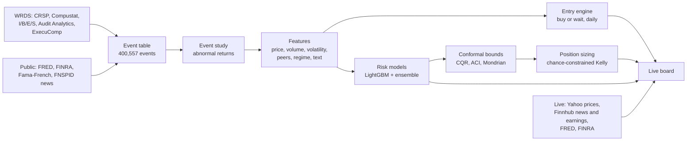
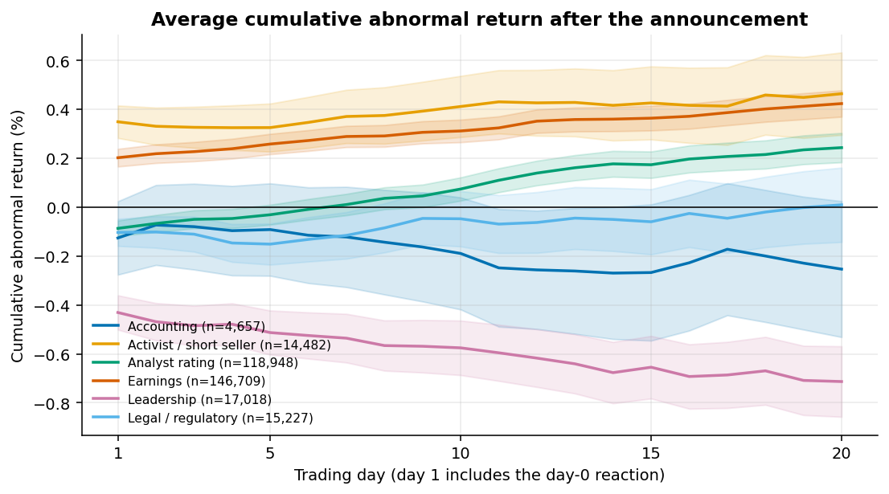
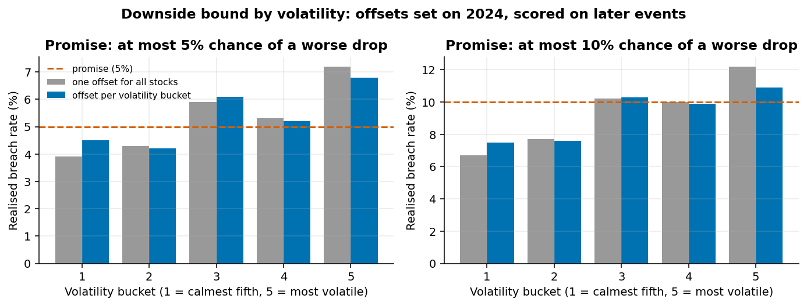
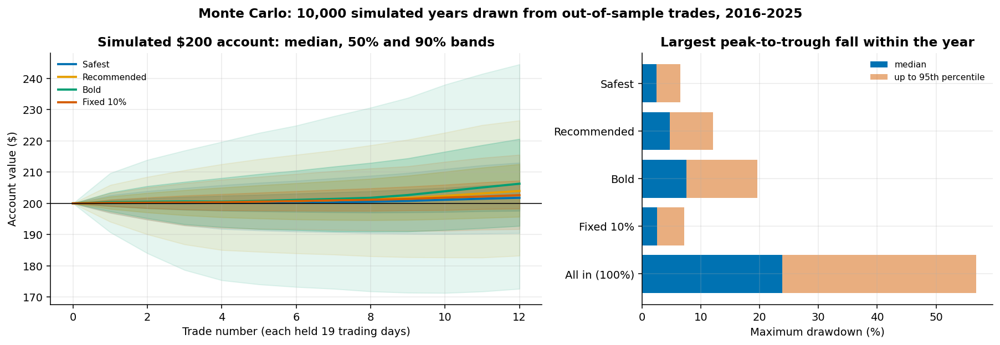

# Event Reaction Model: Risk, Timing and Position Sizing After Company News

This project studies how US stocks behave in the weeks after company-specific news, such as earnings announcements, analyst rating changes, leadership changes, legal and regulatory actions, accounting restatements and activist campaigns. It combines an event study, gradient-boosted models and conformal prediction to answer four practical questions about each event:

1. **Risk:** how volatile will the stock be, how heavy will trading be, and how far could it fall from here?
2. **Timing:** is there a measurable advantage to buying now rather than waiting a few days?
3. **Lows:** when the stock is at a new low, how likely is that low to hold?
4. **Sizing:** what share of an account can be put into the stock while keeping the chance of a large loss within a stated limit?

Every number is tested out of sample on years the models never saw during training or tuning. Results that do not survive these tests are reported as such rather than dropped. A live board applies the trained models to a watchlist each trading day:

**Live board:** https://clairecwn.github.io/StockPredictionModel/

> This is a research project. Do not blindly take this as financial advice, do it at your own risk!

## Contents

1. [Results at a glance](#results-at-a-glance)
2. [Architecture](#architecture)
3. [Data](#data)
4. [Data cleaning](#data-cleaning)
5. [Exploratory analysis](#exploratory-analysis)
6. [Method](#method)
7. [Validation](#validation)
8. [Detailed results](#detailed-results)
9. [Live board](#live-board)
10. [Reproducing the results](#reproducing-the-results)
11. [Repository structure](#repository-structure)
12. [Limitations](#limitations)
13. [References](#references)

## Results at a glance

All figures are out of sample. Test years run from 2006 to 2025 under purged walk-forward validation, which is described in the [Validation](#validation) section. A rank correlation of 0 means no skill and 1 means a perfect ordering of outcomes.

| What is predicted | Out-of-sample skill | Verdict |
|---|---|---|
| Volatility over days 2 to 20, relative to normal | rank correlation 0.48 (shuffled-label placebo 0.00) | Strong |
| Trading volume over days 2 to 20, relative to normal | rank correlation 0.59 | Strong |
| Deepest abnormal drop over days 2 to 20 | rank correlation 0.20; AUC 0.67 for the worst 20% (naive baseline 0.61) | Useful |
| Downside bound ("at most a 10% chance of falling below this") | breached 9.4% of the time in 2021 to 2025 | Calibrated |
| Buy-or-wait rule | entries 0.08 percentage points closer to the 20-day low than buying on day 1 (Holm-adjusted p = 0.001) | Small but significant |
| Position sizing tiers | losses beyond the stated limit in 2.8%, 2.5% and 1.4% of trades, against promises of 5%, 10% and 10% | Promises kept |
| Direction of the 20-day abnormal return | rank correlation 0.03, right sign 51% of the time | Not significant |
| Whether a new low will hold | AUC 0.57, equal to a baseline that only counts days since the event | No added skill |

The pattern is consistent across every method tried. Risk is predictable, because volatility and trading activity cluster in time. Direction is not, because the market prices news within a day or two. The project is therefore built around managing risk rather than forecasting returns.

## Architecture



The pipeline runs in four stages:

1. **Events.** Company news is collected from licensed databases, linked to stock returns, and filtered to a tradeable universe.
2. **Features and targets.** Each event is described by information known at the close of the day after the news, and labelled with what happened over the following weeks.
3. **Models.** Separate models forecast risk, entry timing and downside bounds. Every model is trained and tested with the same time-ordered splits.
4. **Live board.** The same feature code runs on free live data. A parity check confirms that the live features match the training features before any prediction is published.

## Data

| Source | Content | Period | Access |
|---|---|---|---|
| CRSP daily stock file | prices, returns, volume, market index | 2001 to 2025 | WRDS (licensed) |
| Compustat | identifiers, shares outstanding, short interest | 2001 to 2025 | WRDS (licensed) |
| I/B/E/S | earnings announcements, estimates, analyst recommendations | 2001 to 2025 | WRDS (licensed) |
| Audit Analytics | officer changes, legal cases, restatements, shareholder activism | 2001 to 2025 | WRDS (licensed) |
| ExecuComp | executive tenure and ownership | 2001 to 2025 | WRDS (licensed) |
| Fama-French 5 factors and momentum | daily factor returns | 2001 to 2025 | Kenneth French data library |
| FRED | VIX, economic policy uncertainty, high-yield spread, consumer sentiment | 2001 to present | free API |
| FINRA Reg SHO | daily short-sale volume | 2009 to present | free files |
| FNSPID | financial news headlines | 2009 to 2023 | free dataset |
| Yahoo Finance, Finnhub | live prices, company news, earnings calendar | live | free |

**Licence note.** WRDS data is licensed and is not included in this repository. Neither are models trained on it. The code expects the files in a git-ignored `data/` folder, and `docs/WRDS_GUIDE.md` lists exactly which files to download.

**Sample.** The raw event table holds 400,557 events. The tradeable universe keeps events where the stock traded at \$5 or more and was not in the smallest 20% of firms by market value that year. This leaves 317,041 events across 3,400 firms from 2001 to 2025. Small, illiquid stocks are excluded because their prices are noisy and their apparent patterns are too expensive to trade.

## Data cleaning

Raw records from different databases describe the same company with different identifiers and dates, so most of the cleaning work is linking and dating them correctly. The steps run in this order:

1. **Linking.** Compustat and Audit Analytics records are linked to CRSP stocks through the CRSP/Compustat Merged link history, using only links valid on the event date. I/B/E/S records use the official I/B/E/S-CRSP link first, with a CUSIP match as a fallback.
2. **Dating.** Each event is placed on the first trading day on or after its announcement date. Earnings dates come from I/B/E/S announcement dates, and an earnings release takes priority over an analyst rating change on the same firm and day.
3. **Same-day news.** Several items about one firm on one day are merged into a single event. The number of items is kept as a feature.
4. **History requirement.** An event needs at least 120 valid trading days in the estimation window (days $-250$ to $-30$), so that each stock's normal behaviour can be estimated.
5. **Tradeable universe.** Events are kept only if the stock closed at \$5 or more the day before and was not in the smallest 20% of firms by market value that year. This removes 83,516 of the 400,557 events.
6. **Outliers.** Return targets are clipped at their 0.5th and 99.5th percentiles, which removes data errors without discarding events. Volatility and volume ratios are floored at 0.05 before taking logs.
7. **Missing values.** Gradient boosting handles missing values directly, so gaps are left as missing rather than filled with guesses. Series that start late are blank before they begin by design: FINRA short-sale data starts in August 2009 and Compustat short interest in July 2006.
8. **Publication lags.** Every input is dated to when it was actually public. Short-sale volume is lagged one day, executive compensation data is dated July 1 of the following year, consumer sentiment is lagged one month, and short interest uses the raw reported figure rather than one adjusted for later stock splits.

## Exploratory analysis

The event mix is stable over time. Earnings and analyst rating changes make up most of the sample, while the rarer classes add a few thousand events each year.


Average abnormal returns after the announcement differ by event class. Analyst rating changes and leadership changes keep drifting for about 20 days in the direction of the news. Activist events make almost all of their move on days 0 and 1, and earnings events make about half of theirs then. The shaded bands are 95% confidence intervals, and they show that most of these drifts are small compared with the noise around them.



The size of an earnings surprise strongly predicts the immediate reaction but not the drift afterwards. This is the first sign that public news is priced quickly, which the models later confirm.


### 1. Abnormal returns

To separate a company's own news from moves in the wider market, each stock's normal behaviour is estimated over trading days $-250$ to $-30$ before the event with a six-factor model:

```math
r_{i,t} - r_{f,t} = a_i + \boldsymbol{\beta}_i^{\top}\mathbf{f}_t + \varepsilon_{i,t},
\qquad
\mathbf{f}_t = \left(\mathrm{MKT}_t,\ \mathrm{SMB}_t,\ \mathrm{HML}_t,\ \mathrm{RMW}_t,\ \mathrm{CMA}_t,\ \mathrm{UMD}_t\right)^{\top}
```

Single-stock loadings are noisy, so they are shrunk toward a typical stock, with a market beta of 1 and zero on the other factors:

```math
\tilde{\boldsymbol{\beta}}_i = 0.67\,\hat{\boldsymbol{\beta}}_i + 0.33\,\mathbf{e}_1
```

The abnormal return is the part of the return that the factors do not explain. The intercept $a_i$ is left out because past outperformance does not reliably persist:

```math
AR_{i,t} = \left(r_{i,t} - r_{f,t}\right) - \tilde{\boldsymbol{\beta}}_i^{\top}\mathbf{f}_t
```

### 2. Timing convention and targets

Day 0 is the announcement day. All features use only information available at the close of day 1, and every target measures what happens after that point. This means a position could actually be opened at the moment each prediction is made.

| Target | Definition |
|---|---|
| Reaction (feature) | $`CAR_{0,1} = AR_{i,0} + AR_{i,1}`$ |
| Drift | $`D^{(h)}_i = \sum_{t=2}^{h} AR_{i,t}`$ for $`h \in \{5, 20, 60\}`$ |
| Trough | $`T_i = \min_{2 \le k \le 20} \sum_{t=2}^{k} AR_{i,t}`$ |
| Volatility ratio | $`V_i = \dfrac{\sqrt{252}\,\mathrm{sd}\left(r_{i,2:20}\right)}{\sigma_i^{\text{pre}}}`$, where $`\sigma_i^{\text{pre}}`$ is the annualised volatility over days $`-60`$ to $`-1`$ |
| Volume ratio | $`U_i = \dfrac{\overline{\text{vol}}_{i,2:20}}{\overline{\text{vol}}_{i,\text{est}}}`$ |

Return targets are transformed in two ways before training. They are first demeaned within each calendar month, which removes market-wide swings that no stock-level model can predict. They are then divided by the noise expected over the horizon, so that a 5% move in a calm stock counts for more than the same move in a volatile one:

```math
y_i = \frac{D^{(h)}_i - \bar{D}^{(h)}_{m(i)}}{\hat{\sigma}_i \sqrt{h}}
```

Here $\hat{\sigma}_i$ is the stock's daily idiosyncratic volatility before the event and $m(i)$ is the event's month. The volatility and volume ratios are modelled in logs.

### 3. Features

The live models use 53 features, and the research models add the peer, positioning and text groups. The features fall into six groups:

- **Reaction:** $CAR_{0,1}$, the day-0 move in standard deviations, and abnormal volume on days 0 and 1.
- **Stock state:** momentum over 20, 60 and 250 days, distance from the 52-week high, beta, idiosyncratic volatility, Amihud illiquidity, dollar volume and size.
- **Range-based volatility:** Yang-Zhang volatility over 5, 20 and 60 days (a HAR-style term structure) and the size of the reaction-day price range relative to normal.
- **Market regime:** VIX, economic policy uncertainty, the high-yield credit spread and consumer sentiment (lagged one month), plus market returns and volatility.
- **Peers and positioning (research mode):** the reaction of each stock's 10 most correlated peers from the previous year, short interest and the FINRA short-sale ratio (lagged one day).
- **Text (research mode):** supervised sentiment, sentence embeddings, novelty and analogue retrieval from headlines. These are described in the [Text models](#5-text-models) section below.

### 4. Models

**Gradient boosting.** The main model is LightGBM with the Huber loss, which behaves like squared error for small residuals and like absolute error for large ones. This limits the influence of extreme returns:

```math
L_{\delta}(y, \hat{y}) =
\begin{cases}
\tfrac{1}{2}(y - \hat{y})^2 & \text{if } |y - \hat{y}| \le \delta \\
\delta\left(|y - \hat{y}| - \tfrac{1}{2}\delta\right) & \text{otherwise}
\end{cases}
```

Hyperparameters are chosen inside each training window from a small grid. Events at the same firm within 30 days share most of their return window, so each event is down-weighted by its number of overlapping neighbours $n_i$. Each event class is also re-weighted so that the most common classes do not dominate:

```math
w_i = \frac{1}{1 + n_i} \cdot \frac{1}{\sqrt{\pi_{c(i)}}}
```

Here $\pi_{c}$ is the share of events in class $c$.

**Stacked ensemble.** For the volatility, volume and trough targets, LightGBM is combined with extremely randomised trees, ridge regression, a Huber linear model and a 1-D convolutional network. The blend weights are non-negative least-squares weights learned only from earlier test blocks, so the ensemble never sees the data it is scored on.

**Convolutional network.** The CNN reads the last 61 trading days of four channels: volatility-scaled abnormal returns, market returns, log volume and absolute returns. It uses three dilated convolutions with a receptive field of about 29 days, and it predicts the three risk targets jointly.

### 5. Text models

Headlines from days $-5$ to $+1$ around each event are scored in three ways:

- **SESTM** (Ke, Kelly and Xiu, 2019) learns which words go with positive or negative returns in this data. It screens words by how skewed their returns are, estimates positive and negative topic distributions $O^{+}$ and $O^{-}$, and scores each headline by penalised maximum likelihood:

```math
\hat{p} = \arg\max_{p \in [0,1]} \sum_{j} d_j \log\left(p\,O^{+}_j + (1 - p)\,O^{-}_j\right) + \lambda \log\left(p(1-p)\right)
```

  Each year is scored by a model trained only on earlier years. Tickers and words concentrated in a single firm are removed, so that the model cannot learn firm identities.
- **Sentence embeddings** (all-MiniLM-L6-v2) turn each headline into a 384-dimensional vector. These vectors give novelty (distance from the firm's recent news), dispersion across headlines, and the average outcome of the most similar past events.
- **FinBERT** gives a general financial tone score as a benchmark.

### 6. Entry timing

For each event, the entry engine builds one row per decision day $k = 1, \ldots, 15$, giving 4.7 million rows in total. Each row holds the event features plus 24 daily features: the path since the event, the distance from the running low, recent volume, and the close location within the day's range.

The label asks whether the price moves down before it moves up. With the barrier

```math
b = 0.75\,\hat{\sigma}_i\sqrt{5},
```

a row is labelled "waiting pays" if the price falls by $b$ before it rises by $b$ within the next 5 trading days. Rows where neither barrier is hit are left out of the label. A second model predicts the size of the next 5-day move in units of $\hat{\sigma}_i\sqrt{5}$, and the **expected-value rule** buys on the first day this forecast is positive.

As a second opinion, the timing problem is also solved as an optimal stopping problem with fitted Q-iteration. The value of waiting on day $k$ is

```math
V_k(s) = \min\left(P_k,\ C_k(s)\right),
\qquad
C_k(s) = \mathbb{E}\left[V_{k+1}(s') \mid s\right],
\qquad
V_{15}(s) = P_{15}
```

Here $P_k$ is the price relative to the event (in units of $\hat{\sigma}_i$) and $C_k(s)$ is the expected price paid by waiting optimally. The policy buys on day $k$ when $P_k \le C_k(s)$. Each $C_k$ is estimated backwards from day 15 with cross-fitted gradient boosting.

### 7. Downside bounds

A downside bound is a level the stock should fall below with probability at most $\beta$. It is built in three layers.

**Conformalised quantile regression** (Romano, Patterson and Candès, 2019). A quantile model $\hat{q}_\beta(x)$ is fitted, and its errors are measured on a later calibration window:

```math
c = \mathrm{Quantile}_{\lceil (n+1)(1-\beta) \rceil / n}\left(\hat{q}_\beta(x_j) - y_j\right),
\qquad
\text{bound}(x) = \hat{q}_\beta(x) - c
```

**Adaptive conformal inference** (Gibbs and Candès, 2021). In the backtest, the correction is updated month by month using outcomes that are already known (with a two-month lag), so the bound adapts when markets change:

```math
c_{t+1} = c_t + \gamma\left(\mathrm{err}_t - \beta\right), \qquad \gamma = 0.2
```

**Mondrian calibration** (Vovk et al., 2003). The live bound uses a separate correction within each fifth of stocks ranked by volatility. Without it, the promise held on average but was broken for the most volatile stocks.

### 8. Position sizing

Sizing works in total returns over a 19-day holding period. It combines three ingredients.

**Expected return.** A CAPM prior is combined with the event signal, shrunk by the skill the signal has actually shown. This follows Grinold's fundamental law of active management:

```math
\mu_i = \beta_i \cdot \mathrm{ERP} \cdot \frac{h}{252} + \mathrm{IC}_t \cdot \sigma_i^{\text{idio}} \sqrt{\frac{h}{252}} \cdot z_i
```

Here $\mathrm{ERP} = 6\%$ a year, $z_i$ is the standardised drift forecast, and $\mathrm{IC}_t$ is the out-of-sample rank correlation measured only on earlier years. If the signal decays, $\mathrm{IC}_t$ falls and the alpha term shrinks toward zero by itself.

**Risk.** Volatility is the Yang-Zhang estimate scaled by the predicted volatility ratio and by a calibration factor $\kappa_t$, which is also estimated on earlier years only:

```math
\sigma_i = \kappa_t \cdot \sigma_i^{\text{YZ}} \cdot \hat{V}_i \cdot \sqrt{\frac{h}{252}}
```

**Size.** The weight is the smallest of three limits: a chance constraint from the downside bound $q_\beta$, fractional Kelly, and a hard cap:

```math
w_i = \min\left(\frac{d}{\left|q_{\beta,i}\right|},\ \ k\,\frac{\mu_i}{\sigma_i^{2}},\ \ \text{cap}\right)
```

The first term is the exact single-stock solution of $\Pr\left(\text{loss} > d \text{ of the account}\right) \le \beta$. The three tiers are:

| Tier | Loss limit $`d`$ | Chance $`\beta`$ | Kelly fraction $`k`$ | Cap |
|---|---|---|---|---|
| Safest | 2% | 5% | 1/4 | 15% |
| Recommended | 4% | 10% | 1/2 | 25% |
| Bold | 8% | 10% | 3/4 | 40% |

**Several stocks at once.** When an account is split across up to three stocks, each stock's bad-case loss $\ell_j = w_j\left|q_j\right|$ is combined through a Ledoit-Wolf shrunk correlation matrix $C$ from the past 250 days. Correlations rise in sell-offs (Longin and Solnik, 2001), so $C$ is stressed toward 1 before use:

```math
C_s = C + 0.4\left(\mathbf{1}\mathbf{1}^{\top} - C\right),
\qquad
L_{\text{basket}} = \sqrt{\boldsymbol{\ell}^{\top} C_s\, \boldsymbol{\ell}}
```

All weights are scaled down until $L_{\text{basket}} \le d$, and the total invested never exceeds 80% of the account.

## Validation

Financial data makes overfitting easy, so the evaluation is deliberately strict.

- **Purged walk-forward splits.** Test blocks are 2006 to 2010, 2011 to 2015, 2016 to 2020 and 2021 to 2025. Each model is trained only on data from before its test block, with a 120-day gap so that return windows never overlap.
- **Shuffled-label placebos.** Every model is re-run with shuffled targets. Real skill must clearly beat the placebo.
- **Naive baselines.** Downside models must beat a simple ridge regression on the reaction and pre-event volatility, and the "new low" model must beat a model that only counts days since the event.
- **Multiple-testing correction.** Trading rules and entry strategies are compared with Holm-adjusted p-values. The t-statistics are computed on monthly averages, because events in the same month are not independent.
- **Untouched test period.** Thresholds and tier settings are chosen on 2006 to 2015 and reported on 2016 to 2025.
- **Leakage audit.** The pipeline was checked for look-ahead bias, and several leaks were found and fixed: same-day short-sale data, split-adjusted short interest, compensation data dated before its release, and earnings dates known only after the fact. Each is now lagged to the date it was actually public.

## Detailed results

### Risk forecasts

| Target | Ridge (live features) | LightGBM (live features) | Stacked ensemble (all features) | Placebo |
|---|---|---|---|---|
| Volatility ratio, days 2 to 20 | 0.41 | 0.47 | 0.48 | -0.01 |
| Volume ratio, days 2 to 20 | 0.42 | 0.57 | 0.59 | 0.01 |
| Trough, days 2 to 20 | 0.15 | 0.19 | 0.20 | 0.08 |
| Drift, days 2 to 20 | 0.02 | 0.03 | 0.03 | 0.00 |

The values are Spearman rank correlations, computed out of sample. The first two columns come from the models used on the live board, and the ensemble column from the full research models. The 80% prediction intervals contain the realised outcome 80% of the time for every target, and they are narrower for large firms than for small ones.

The figure below sorts events into ten groups by their prediction and compares the average prediction with the average outcome in each group. For volatility and volume, the realised values rise steadily with the prediction. For the 20-day drift, the realised line is almost flat, which is what a rank correlation of 0.03 looks like.


### Drift and earnings surprises

Post-earnings announcement drift (Bernard and Thomas, 1989) does not appear in this sample. Average 60-day drift is flat across deciles of standardised earnings surprise, even though the day-0 and day-1 reaction rises steadily from $-4.1\%$ for the worst misses to $+3.4\%$ for the biggest beats. This matches recent evidence that the anomaly has disappeared in liquid stocks (Martineau, 2022). A long-short drift strategy earns a positive raw return over 2006 to 2025, but no version is significant after the Holm correction, and returns since 2021 are negative after trading costs.

### Entry timing (2016 to 2025, untouched)

| Strategy | Average distance above the 20-day low | Holm-adjusted p vs day 1 |
|---|---|---|
| Buy at the close of day 1 | 4.83% | |
| Expected-value rule | 4.74% | 0.001 |
| Optimal stopping (fitted Q-iteration) | 4.74% | 0.09 |

The live board uses the expected-value rule retrained on live features, which keeps a smaller but still significant edge (4.78%, Holm-adjusted p = 0.03).

### Position sizing ($200 account, 2016 to 2025)

| Tier | Average stake | Promise | Realised breach rate | Worst 1% outcome |
|---|---|---|---|---|
| Safest | \$`20.86 | at most 5% chance of losing more than \`$4 | 2.8% | \$-5.56 |
| Recommended | \$`39.44 | at most 10% chance of losing more than \`$8 | 2.5% | \$-10.89 |
| Bold | \$`63.67 | at most 10% chance of losing more than \`$16 | 1.4% | \$-17.85 |

With a single correction for all stocks, the calmest fifth was over-protected and the most volatile fifth broke the 10% promise (12.2%). Calibrating each volatility bucket separately brings that down to 10.9%. Part of the remaining gap comes from 2025 being a riskier year than 2024, when the offsets were set, which affected every bucket.



When three stocks are bought on the same day, scaling the basket with the stressed correlation keeps the breach rate at 6.7% against a promise of 10%. Sizing each stock separately and adding the results breaches 17.4% of the time.

### Monte Carlo simulation of an account

The backtest shows what happened trade by trade, but not what a year of trading could look like. To see this, a \$200 account is simulated 10,000 times. Each simulated year draws one calendar year from 2016 to 2025 at random, so that calm and stressed markets appear in realistic proportions. It then takes 12 trades from that year in date order, since each position is held for 19 trading days. Each trade invests the tier's weight $w$ of the current balance:

```math
A_{k} = A_{k-1}\left(1 + w_k\, R_k\right),
\qquad
\text{drawdown} = \max_{k}\left(1 - \frac{A_{k-1}\left(1 + w_k\, L_k\right)}{\max_{j < k} A_j}\right)
```

Here $R_k$ is the trade's 19-day total return and $L_k$ is its worst point while held. Every trade comes from the out-of-sample backtest, so no simulated result uses a model that saw the outcome. The same simulation is run for a fixed 10% stake and for putting the whole account into every trade.

| Strategy | Median end value | 90% range of end value | Chance of ending down 10% or more | Median largest fall | 95th percentile largest fall |
|---|---|---|---|---|---|
| Safest | \$`202.06 | \`$190.66 to \$213.10 | 0.6% | 2.5% | 6.6% |
| Recommended | \$`203.88 | \`$183.24 to \$226.35 | 3.1% | 4.7% | 12.2% |
| Bold | \$`206.46 | \`$172.64 to \$244.48 | 9.5% | 7.6% | 19.4% |
| Fixed 10% stake | \$`202.62 | \`$191.76 to \$215.55 | 0.2% | 2.6% | 7.2% |
| All in (100%) | \$`219.17 | \`$121.67 to \$390.55 | 27.3% | 23.9% | 56.8% |

The tiers behave as designed. Moving from Safest to Bold raises the median result, but it also widens the range and deepens the worst falls. Putting the whole account into every trade has the highest median, because stocks rose on average over 2016 to 2025, but it also loses 10% or more in about one simulated year in four, with a typical fall of nearly a quarter of the account.

The simulation also shows a limit of the model. The Safest tier does no better than simply staking a fixed 10% on every trade, because the expected-return signal is too weak to pick better trades. The value of the sizing rules lies in keeping each tier's losses inside a stated limit, not in raising returns.



### Why the headline numbers are modest

Published stock models often report directional accuracy of 90% or more. In almost every case, figures like this come from one of five problems:

1. **Look-ahead bias:** features that were not yet known on the prediction date.
2. **Price-level targets:** tomorrow's price is close to today's, so any model looks accurate.
3. **Class imbalance:** most days have small moves, so predicting "small move" always scores well.
4. **Test-set selection:** many models are tried and the best test score is reported.
5. **Single-stock or single-period tests:** a pattern that held for one stock in one period rarely generalises.

This project avoids all five, so its accuracy for direction sits close to 50%, which is consistent with efficient pricing of public news. A directional accuracy far above that on this kind of data would be treated as a sign of leakage rather than as success.

## Live board

<!-- LIVE-BOARD:START -->
_Updated 2026-11-16 12:04 UTC. Research only, not financial advice._

| Stock | Price | Event (day 0) | Day | Signal | Expected further dip | 1-in-10 worst point (20 days) | Risk vs normal | Recommended share if buying |
|---|---|---|---|---|---|---|---|---|
| NVDA | 162.85 | price/volume shock, no matched news (2026-11-12) | 1 | BUY ⚠️ | 5.3% | -14.5% | 0.97x | 15% |
| TSLA | 390.22 | price/volume shock, no matched news (2026-11-04) | 7 | WAIT ⚠️ | 4.5% | -13.4% | 0.91x | 25% |
| META | 641.69 | quiet: no event in the last 15 trading days | | | | | | |
| BABA | 94.38 | price/volume shock, no matched news (2026-11-05) | 6 | BUY ⚠️ | 4.5% | -16.5% | 1.09x | 8% |
| BA | 171.50 | earnings guidance (2026-10-27) | 13 | WAIT | 2.3% | -10.4% | 0.95x | 25% |
| INTC | 59.66 | earnings guidance (2026-10-29) | 11 | BUY ⚠️ | 5.7% | -21.9% | 0.94x | 18% |
| AAPL | 356.27 | earnings guidance (2026-11-02) | 9 | WAIT | 2.4% | -5.8% | 1.03x | 11% |
| GRAB | 3.24 | price/volume shock, no matched news (2026-11-05) | 6 | WAIT ⚠️ | 4.5% | -18.7% | 0.88x | 6% |
| SE | 75.36 | earnings guidance (2026-11-10) | 3 | WAIT ⚠️ | 5.1% | -14.5% | 1.07x | 17% |
<!-- LIVE-BOARD:END -->

The board runs on GitHub Actions twice per trading day, once after the US close and once in the morning to refresh headlines. Each run follows six steps:

1. Download daily prices for the watchlist and SPY. An unfinished intraday bar is never used, because the models were trained on closing values.
2. Look for an event in the last 15 trading days. An earnings date from the calendar comes first, then a classified headline that names the company, then an unexplained price or volume shock. Events are dated to the announcement day, which is the same convention as in training.
3. Rebuild the features with the same code that was checked against the training data. Over 1,500 historical events, the live code matches the training values with rank correlations of 0.97 to 1.00.
4. Predict risk, entry timing and sizing with the live models. These models are retrained on the 53 features that free data can supply.
5. Publish `docs/data/predictions.json`, which drives the page, and update the table above.
6. Log each prediction in `docs/data/forward_log.csv` and score it once its 20-day outcome is known. This gives a forward test that cannot be affected by look-ahead.

The page includes a calculator that turns an account size into dollar amounts for each tier and for a split across up to three stocks.

## Reproducing the results

**Requirements.** Python 3.9 or later, about 16 GB of RAM, WRDS access for the licensed files, and free API keys for FRED and Finnhub.

```bash
git clone https://github.com/clairecwn/StockPredictionModel.git
cd StockPredictionModel
python -m venv .venv && source .venv/bin/activate
pip install -r requirements.txt
cp .env.example .env        # add FRED_API_KEY and FINNHUB_API_KEY
```

Download the WRDS files listed in `docs/WRDS_GUIDE.md` into `data/raw/wrds/`, then run the steps in order:

| Step | Command | Output |
|---|---|---|
| Market regime data | `python src/s01_fred.py` | `data/raw/public/fred_daily.csv` |
| Event table and event study | `python src/s02_events.py` | `data/processed/events.parquet` |
| Extra, peer and short-interest features | `python src/s02c_extra_features.py` and `python src/s02d_peer_features.py` | feature tables |
| Short-sale volume | `python src/s03d_finra_shortvol.py` | FINRA features |
| News and text features (optional) | `python src/s03a_news_extract.py`, `s03e_sestm.py`, `s03f_text.py` | text features |
| CNN (optional) | `python src/s03g_cnn.py` | CNN predictions |
| Risk models | `python src/s03_train.py` | `results/report.md` |
| Entry engine | `python src/s05_entry_engine.py` | `results/entry_engine.md` |
| Position sizing | `python src/s06_sizing.py` and `python src/s06c_mondrian.py` | `results/sizing.md` |
| Live models and parity check | `./run_live_models.sh` | `models/live/`, `results/parity.md` |
| Live board | `LIVE_FEATS=1 python src/s09_live_board.py` | `docs/data/predictions.json` |
| Figures and Monte Carlo | `LIVE_FEATS=1 python src/s12_figures.py` | `docs/figures/` |

A full run takes about 6 to 8 hours on a laptop. Most of that time is spent in the walk-forward training and the entry engine.

## Repository structure

```
├── src/
│   ├── config.py, modeling.py      paths, features, targets, folds, model definitions
│   ├── s01 to s03g                 data, events, features, text models, risk models
│   ├── s05_entry_engine.py         buy-or-wait models and optimal stopping
│   ├── s06*_sizing*.py             downside bounds and position sizing
│   ├── live_engine.py              live feature rebuild and predictions
│   ├── s08_parity.py               live vs training feature check
│   ├── s09_live_board.py           daily board
│   └── s11_forward_eval.py         forward-test scoring
├── docs/                           live page (index.html), its data and the README figures
├── watchlist.json                  stocks shown on the live board
└── requirements*.txt
```

## Limitations

- **Direction is not predictable here.** The 20-day drift forecast is shown only as a weak lean and is never used for sizing.
- **Events with no matched news** do not resemble the training data, which consists of news and earnings events. The page labels these events and they should be read with extra caution.
- **The news history ends in 2023.** Text features are therefore used in research mode only, and the live models rely on price, volume and regime data.
- **Live data differs slightly from research data.** Live abnormal returns use a market model with SPY rather than six factors with the CRSP index. The parity check measures this gap, which is small (rank correlation 0.98 for the reaction).
- **Coverage.** Results apply to US stocks above \$5 and outside the smallest 20% of firms. They also assume market conditions similar to those from 2001 to 2025.
- **Calibration drifts.** Downside bounds were checked on 2024 and 2025, when risk was higher than usual, and the most volatile fifth of stocks still breached slightly above its promise (10.9% against 10%). The forward test will show whether this persists.

## References

- Bernard, V. and Thomas, J. (1989). Post-earnings-announcement drift: delayed price response or risk premium? *Journal of Accounting Research*.
- Fama, E. and French, K. (2015). A five-factor asset pricing model. *Journal of Financial Economics*.
- Gibbs, I. and Candès, E. (2021). Adaptive conformal inference under distribution shift. *NeurIPS*.
- Grinold, R. and Kahn, R. (2000). *Active Portfolio Management*. McGraw-Hill.
- Ke, Z., Kelly, B. and Xiu, D. (2019). Predicting returns with text data. NBER Working Paper.
- Ledoit, O. and Wolf, M. (2004). A well-conditioned estimator for large-dimensional covariance matrices. *Journal of Multivariate Analysis*.
- Longin, F. and Solnik, B. (2001). Extreme correlation of international equity markets. *Journal of Finance*.
- López de Prado, M. (2018). *Advances in Financial Machine Learning*. Wiley.
- Martineau, C. (2022). Rest in peace post-earnings announcement drift. *Critical Finance Review*.
- Romano, Y., Patterson, E. and Candès, E. (2019). Conformalized quantile regression. *NeurIPS*.
- Vovk, V., Lindsay, D., Nouretdinov, I. and Gammerman, A. (2003). Mondrian confidence machine. Technical report, Royal Holloway.
- Yang, D. and Zhang, Q. (2000). Drift-independent volatility estimation based on high, low, open and close prices. *Journal of Business*.

## Disclaimer

This is a research project. Its outputs describe historical patterns and their measured uncertainty. They are not investment advice and do not recommend buying or selling any security.
